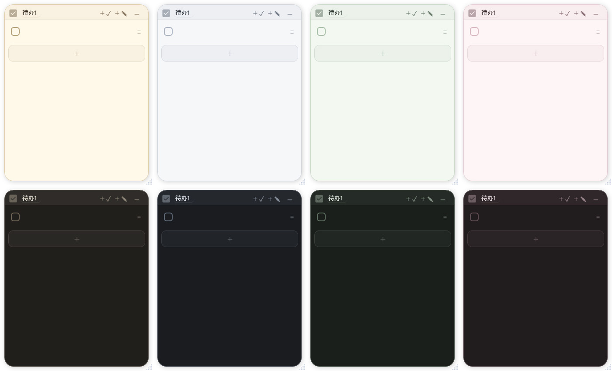
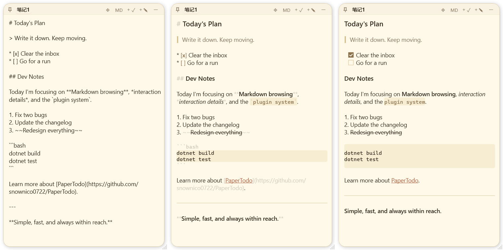
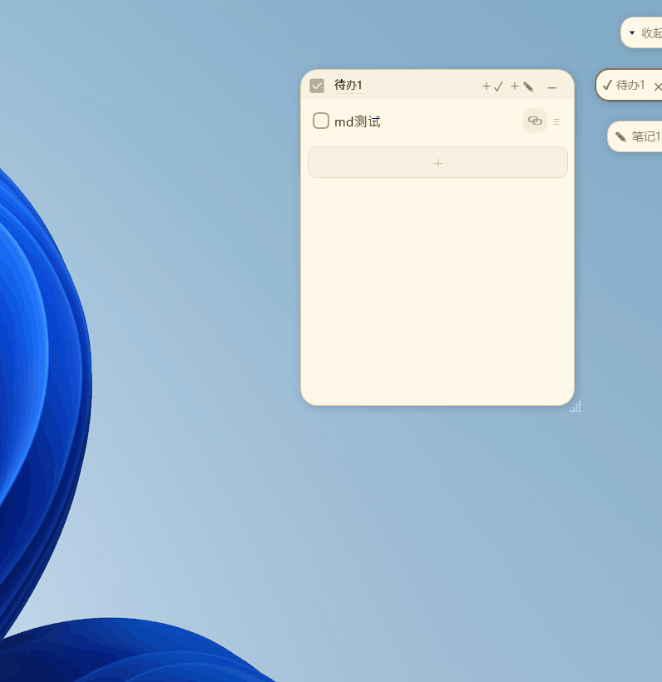

<h1 align="center">PaperTodo · 一张纸</h1>

<p align="center">
  <strong>让桌面上有几张安静、顺手、不打扰人的纸。</strong><br>
  一个轻量、原生、自由扩展的 Windows 桌面便签工具。
</p>

<p align="center">
  <a href="https://apps.microsoft.com/detail/9pnfp27sjx13"></a><br>
  <sub>PaperTodo 仍可在 GitHub 免费下载。如果你愿意支持项目持续维护，欢迎前往微软商店自愿购买，非常感谢！</sub>
</p>

<p align="center">
  
  
  
  
  <a href="https://hellogithub.com/repository/snownico0722/PaperTodo" target="_blank"></a>
</p>

<p align="center">
  <strong>语言：简体中文 | <a href="README.md">English</a></strong><br>
  <a href="https://snownico0722.github.io/PaperTodo/">官方网站（含在线交互演示）</a><br>
  <a href="doc/USER_GUIDE.md">用户手册</a> · <a href="plugin-samples/README.zh.md">插件开发手册</a> · <a href="CHANGELOG.zh.md">更新日志</a><br>
  <a href="https://qm.qq.com/q/Mp7spYLrig">QQ 交流群：551612664——奇奇怪怪的魔法研究基地</a>
</p>

---

## 界面预览

| 桌面纸片 |
| :---: |
|  |

| Markdown 实时排版 |
| :---: |
|  |

| 边缘悬停预览 |
| :---: |
|  |

| 胶囊模式 | 自动贴边 |
| :---: | :---: |
|  |  |
| 不用时收起成小胶囊，把桌面让出来。 | 贴靠在屏幕边缘，鼠标移上去再滑出查看。 |

---

## 设计理念

- **纸片优先** — 每张纸都是独立的桌面窗口，没有厚重的中心管理台，打开就能直接写。
- **随手即用** — 想到什么就记下来，做完顺手打勾；所有修改自动保存，尽量缩短操作路径。
- **不必折腾管理** — 不引入复杂的分类、标签和项目层级，把精力留给事情本身。
- **原生轻量** — 基于 .NET 10 与 WPF 原生构建，不使用浏览器套壳，启动快、常驻内存占用低。
- **安静克制** — 需要时抬手可得，不需要时收在屏幕边缘，不抢焦点、不刷存在感。

> 不堆叠多余的交互层级，也不制造额外的视觉负担。

---

## 核心特性

### 1. 两种日常纸片：待办与笔记
- **待办纸（Todo）**：清爽好用的任务清单。支持单条内换行（`Shift+Enter`）与长内容折叠、滑动框选批量处理、整组保序拖拽、多行粘贴自动拆分，以及倒计时提醒；已完成事项可设为自动置底或直接清除。
- **笔记纸（Note）**：轻量图文备忘。提供纯文本、基础高亮与**完全渲染**三档模式，在完全渲染下可以一边保持排版一边编辑、直接点击任务方框；支持粘贴或拖入本地图片、长文档局部增量解析，也可随时导出为 Markdown、内嵌图片的 HTML 或批量 ZIP 压缩包。
- **纸片与文件互链**：把另一张纸片或电脑里的常用文件、文件夹直接拖到待办项上，之后点一下就能打开。

### 2. 边缘胶囊、悬停预览与自由队列
- **折叠贴边**：点击右上角或按 `Ctrl+W`，就能把纸片收成屏幕侧边的小胶囊，把桌面空间腾出来。
- **悬停预览卡片**：鼠标停在边缘胶囊上即可弹出轻量卡片——不用展开大窗口，就能直接在卡片里滚动查看、勾选待办、打开关联文件，或浏览排版好的 Markdown 笔记；沿着一排胶囊滑动时会自动平滑接续。
- **自由队列与跨屏调度**：开启自由队列后，可以把单颗胶囊拖出来独立成组；拖动主胶囊或按住 `Ctrl` 拖拽，就能把整组胶囊一起挪到屏幕另一侧或其他显示器。
- **高刷与混合缩放适配**：折叠、滑出、让位与跨屏拖拽均针对 120Hz / 144Hz+ 高刷新率屏幕和多显示器不同 DPI 环境做过细致调校，过渡自然跟手。

### 3. 多工作区与本地数据保护
- **最多 5 个独立工作区**：工作、个人记录或不同项目可以分开存放，各自的纸片、图片和插件数据互不干扰；副工作区默认继承主工作区的软件设置，也支持把单张纸片直接移动到其他工作区。
- **纯本地离线存储**：所有文字与图片都保存在程序目录内（`data.json` 与 `note-assets.lmdb`），无需注册账号，也不依赖云端。
- **自动梯度备份与异常恢复**：除日常写入保护与本地固定备份外，程序还会在 `PaperTodo-backups/` 下自动维护跨度约 10 分钟、6 小时、3 天和 1 个月的历史备份包；遇到意外断电或文件损坏时，会自动尝试恢复或引导找回可用备份。

### 4. 原生材质、外观定制与桌面融入
- **主题、五套配色与七种皮肤**：支持浅色、深色与跟随系统，内置暖纸、墨、林、霞、素灰五套配色，并提供默认纸片、标准云母、标准亚克力、透色亚克力、半透明描图纸、Aero 玻璃和像素风七种皮肤；在 Windows 11 22H2+ 上可启用系统原生材质与五档背景透明度调节。
- **顺手定制**：顶栏快捷按钮支持按需拖拽排布或收进 `···` 菜单；支持放入 `papertodo.ttf` 替换自定义字体、设置纸片背景图，以及切换中、英、日、韩多语言界面。
- **窗口跟随与桌面置底**：支持将纸片绑定到第三方软件窗口旁随其移动和最小化，也支持失焦自动收起、静置淡化，或一键置底并开启鼠标穿透。

### 5. 脚本、插件微应用与本地 AI 协作
- **PowerShell 脚本入口**：在笔记首行写上 `!p` 再折叠，纸片就会变成带闪电图标的脚本胶囊，点一下即可运行；也可以在顶栏或菜单里配置一段随时调用的公共脚本。
- **插件系统（API 2.3）**：纸片正文可切换为时钟、专注番茄钟、待办复盘记录池、Webhook 事件转发等 Web 或 WPF 原生插件；在设置中可单独启停各个插件，放入 `plugins/` 目录即可识别。
- **本地 MCP 与 Codex 联动**：内置标准 `--mcp` 本地接口（含细粒度读写权限、三方数据合并与笔记图片导入），方便 Claude、Cursor 等本地 AI 工具安全读写纸片；搭配 **Codex CLI Bridge** 插件，还能从待办或纸片顶栏一键把任务发给本机 Codex 处理。

---

## 常用操作与快捷键速查

| 操作 | 快捷键 / 触发方式 | 说明 |
| :--- | :--- | :--- |
| **折叠 / 隐藏纸片** | <kbd>Ctrl</kbd> + <kbd>W</kbd> 或顶栏中键 | 开启胶囊模式时收起为胶囊，关闭时隐藏纸片 |
| **取消当前操作 / 收起** | <kbd>Esc</kbd> | 关闭搜索栏或取消多选、拖拽；无其他状态时收起纸片 |
| **全文搜索** | <kbd>Ctrl</kbd> + <kbd>F</kbd> | 搜索当前工作区的全部待办与 Markdown 笔记并跳转定位 |
| **新建待办 / 项内换行** | <kbd>Enter</kbd> / <kbd>Shift</kbd> + <kbd>Enter</kbd> | 待办纸中回车新建下一条，`Shift+Enter` 在同一条内换行 |
| **撤销 / 重做** | <kbd>Ctrl</kbd> + <kbd>Z</kbd> / <kbd>Ctrl</kbd> + <kbd>Y</kbd> | 待办与笔记通用（包含多行粘贴与框选批量删除） |
| **笔记常用格式** | <kbd>Ctrl</kbd> + <kbd>B</kbd> / <kbd>I</kbd> / <kbd>K</kbd> | 加粗、斜体、插入超链接 |
| **笔记字号缩放** | <kbd>Ctrl</kbd> + 滚轮 | 缩放正文字号，点击右下角百分比可恢复 `100%` |
| **召回全部纸片** | 双击系统托盘图标 | 显示当前工作区所有纸片，并将移出屏幕的窗口拉回可见区域 |

---

## 下载与运行

PaperTodo 是免安装的绿色单文件程序。前往 [Releases 页面](https://github.com/snownico0722/PaperTodo/releases/latest) 按环境选择即可：

- **`PaperTodo-...-self-contained.exe`（推荐）**：已内置 .NET 运行时，下载后双击即可直接运行。
- **`PaperTodo-...-no-runtime.exe`**：体积更小，适合已安装 **.NET 10 Desktop Runtime (x64)** 的电脑。

> **使用提示**：请新建一个有读写权限的固定文件夹（例如 `D:\Apps\PaperTodo\`），把程序放进去再运行；不要直接在压缩包预览窗口或只读系统目录里打开，以免数据无法落盘。在程序旁放置 `PaperTodo.ico` 可自定义托盘图标。

启动后桌面上会出现第一张待办纸，系统托盘也会常驻 PaperTodo 图标。如果纸片被其他窗口挡住，或拔掉外接显示器后跑出了屏幕，**双击托盘图标**就能把它们找回来。

---

## 详细文档导航

- 📖 **[完整用户手册](doc/USER_GUIDE.md)**：涵盖快速上手、待办与笔记详细用法、边缘胶囊与自由队列、工作区与 MCP 配置、数据备份恢复及常见问题解答。
- 🧩 **[插件开发手册](plugin-samples/README.zh.md)**：介绍 Web 与 Native 插件的运行机制、`plugin.json` 配置、API 2.3 能力边界与示例工程索引。
- 📋 **[版本更新日志](CHANGELOG.zh.md)**：查看各版本的新功能、体验改进与问题修复记录。

---

## 本地构建

在 Windows 上安装 .NET 10 SDK 后即可本地编译：

```powershell
git clone --recurse-submodules https://github.com/snownico0722/PaperTodo.git
cd PaperTodo
dotnet build PaperTodo.csproj -c Release
```

如果克隆仓库时没有拉取子模块，请先补齐子模块再编译：

```powershell
git submodule update --init --recursive
dotnet build PaperTodo.csproj -c Release
```

---

## 反馈与参与贡献

- 问题反馈与功能建议：[GitHub Issues](https://github.com/snownico0722/PaperTodo/issues)
- 提交代码前请先阅读：[贡献指南](CONTRIBUTING.md)
- QQ 交流群：[551612664（奇奇怪怪的魔法研究基地）](https://qm.qq.com/q/Mp7spYLrig)

感谢 [linux.do](https://linux.do/) 社区的支持。