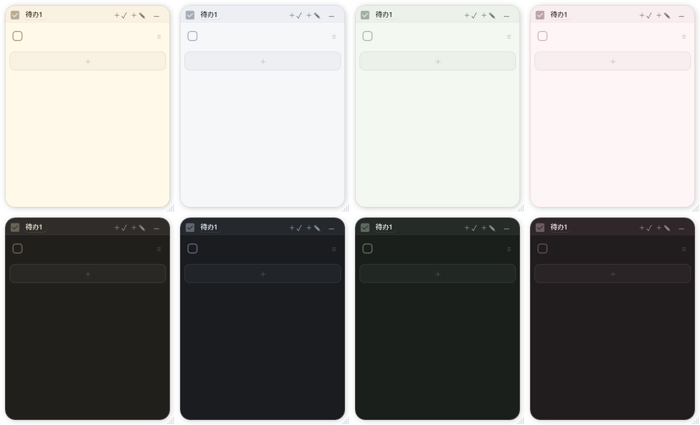
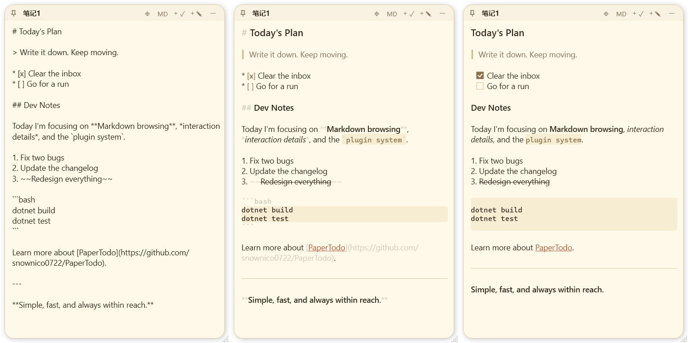
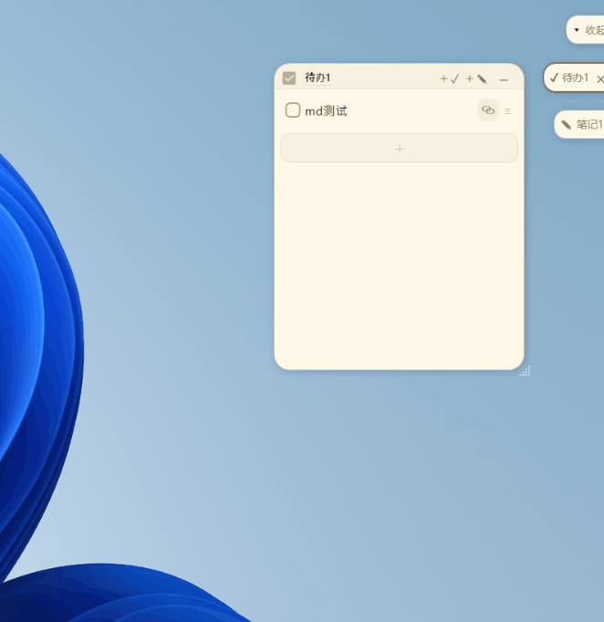
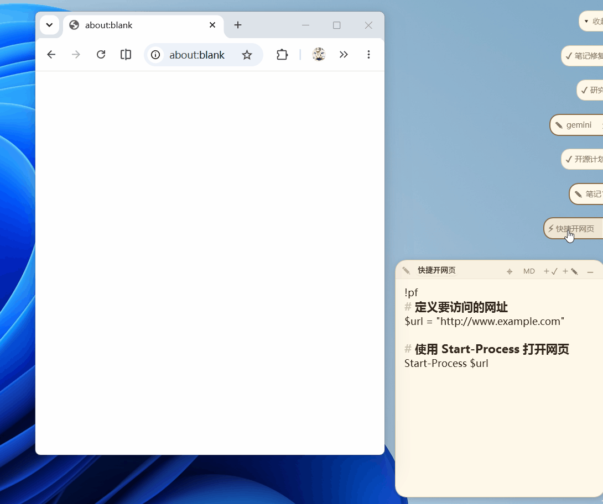
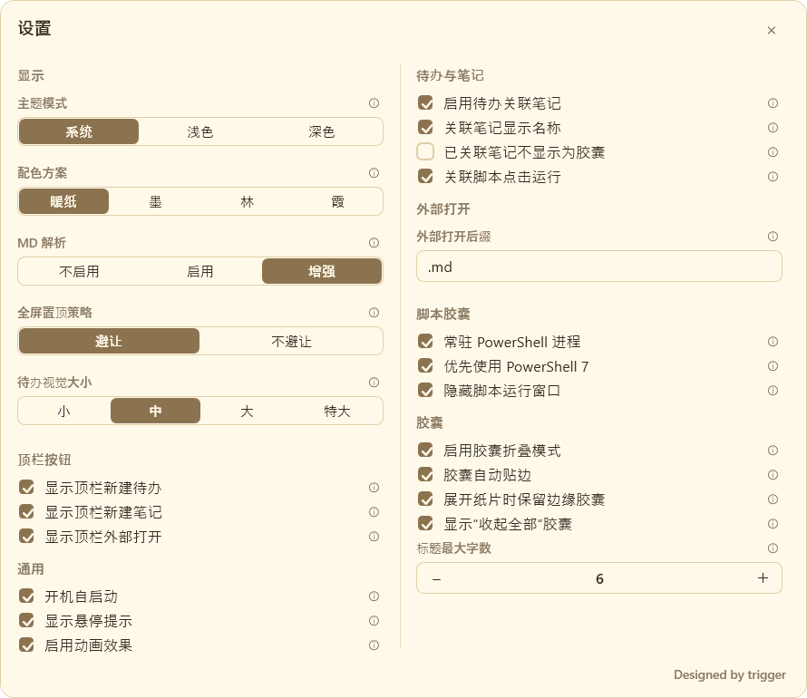

# PaperTodo User Manual

**Language: English | [简体中文](USER_GUIDE.md)**

> **Related Links**: [Back to Home](../README.md) · [Plugin Development Manual](../plugin-samples/README.md) · [Changelog](../CHANGELOG.md)
>
> This manual follows **the current main branch**, including features listed under **Unreleased** in the changelog. Released 4.0.0-beta1 builds and older downloads may not include every feature; check the changelog for your installed version. Screenshots illustrate basic operations; follow your version's actual settings layout.

This manual is for everyday users of PaperTodo. Start with [1. Quick Start](#1-quick-start), then use the table of contents to look up individual features.

---

## Table of Contents

- [1. Quick Start](#1-quick-start)
  - [1.1 Installation and Editions](#11-installation-and-editions)
  - [1.2 First Launch and Interface Overview](#12-first-launch-and-interface-overview)
  - [1.3 Getting Started with Your First Paper](#13-getting-started-with-your-first-paper)
- [2. Common Paper Operations](#2-common-paper-operations)
  - [2.1 Expanded and Capsule States](#21-expanded-and-capsule-states)
  - [2.2 Top Bar and Paper Menu](#22-top-bar-and-paper-menu)
  - [2.3 Moving, Resizing, and Windows Snap](#23-moving-resizing-and-windows-snap)
  - [2.4 Collapse, Hide, Delete, and Exit](#24-collapse-hide-delete-and-exit)
  - [2.5 Full-Text Search](#25-full-text-search)
  - [2.6 Exporting Todos and Notes](#26-exporting-todos-and-notes)
- [3. Todo Papers](#3-todo-papers)
  - [3.1 Adding and Editing Items](#31-adding-and-editing-items)
  - [3.2 Reordering, Deleting, and Batch Actions](#32-reordering-deleting-and-batch-actions)
  - [3.3 Completed Items](#33-completed-items)
  - [3.4 Linking Papers and Local Files](#34-linking-papers-and-local-files)
  - [3.5 Todo Reminders](#35-todo-reminders)
- [4. Note Papers](#4-note-papers)
  - [4.1 Rendering Levels and Editing](#41-rendering-levels-and-editing)
  - [4.2 Supported Markdown Syntax](#42-supported-markdown-syntax)
  - [4.3 Inserting and Managing Local Images](#43-inserting-and-managing-local-images)
  - [4.4 Opening in an External Editor](#44-opening-in-an-external-editor)
- [5. Edge Capsules and Hover Previews](#5-edge-capsules-and-hover-previews)
  - [5.1 Edge Capsules and Docking](#51-edge-capsules-and-docking)
  - [5.2 Hover Preview Cards](#52-hover-preview-cards)
  - [5.3 Multi-Monitor Queues and Reordering](#53-multi-monitor-queues-and-reordering)
  - [5.4 Master Capsule and Queue Control](#54-master-capsule-and-queue-control)
- [6. Script Capsules (PowerShell)](#6-script-capsules-powershell)
  - [6.1 Script Directives](#61-script-directives)
  - [6.2 Running Scripts and Persistent Processes](#62-running-scripts-and-persistent-processes)
  - [6.3 Run script shortcut](#63-run-script-shortcut)
  - [6.4 Security Notes](#64-security-notes)
- [7. Keyboard Shortcuts](#7-keyboard-shortcuts)
  - [7.1 Built-in Paper Shortcuts](#71-built-in-paper-shortcuts)
  - [7.2 Global Shortcuts](#72-global-shortcuts)
  - [7.3 Edge Capsule Quick Launch (1~9)](#73-edge-capsule-quick-launch-19)
- [8. Settings Reference](#8-settings-reference)
  - [8.1 General, Todo, and Note Settings](#81-general-todo-and-note-settings)
  - [8.2 Visual Appearance, Backgrounds, and Fonts](#82-visual-appearance-backgrounds-and-fonts)
  - [8.3 Shortcut Settings](#83-shortcut-settings)
  - [8.4 Installing and Configuring Plugins](#84-installing-and-configuring-plugins)
  - [8.5 Labs Features](#85-labs-features)
  - [8.6 Workspaces](#86-workspaces) · [Local MCP interface](#local-mcp-interface) · [External data merge](#reloading-or-merging-externally-edited-data)
- [9. System Tray and Command-Line Arguments](#9-system-tray-and-command-line-arguments)
  - [9.1 System Tray Menu](#91-system-tray-menu)
  - [9.2 Command-Line Arguments](#92-command-line-arguments)
- [10. Data Backup, Migration, and Recovery](#10-data-backup-migration-and-recovery)
  - [10.1 Data Files and Directory Structure](#101-data-files-and-directory-structure)
  - [10.2 Backing Up Data](#102-backing-up-data)
  - [10.3 Migrating to a New PC and Restoring Data](#103-migrating-to-a-new-pc-and-restoring-data)
- [11. Frequently Asked Questions (FAQ)](#11-frequently-asked-questions-faq)

---

## 1. Quick Start

### 1.1 Installation and Editions

Download the portable Windows x64 build from the GitHub [Releases page](https://github.com/snownico0722/PaperTodo/releases). The file-placement and migration steps below apply to the portable edition; check the changelog for your download, as **Unreleased** features require a newer build that includes them.

| Edition Identifier | Characteristics | Recommended For |
| :--- | :--- | :--- |
| `self-contained.exe` | Includes the .NET runtime | **Most users**; runs without a separate runtime installation |
| `no-runtime.exe` | Excludes the .NET runtime; see the download page for file size | Systems with **.NET 10 Desktop Runtime (x64)** installed |

> [!IMPORTANT]
> Create a dedicated writable folder (such as `D:\Apps\PaperTodo\`) and run `PaperTodo.exe` from there.
> **Do not** run from a temporary extraction directory or a read-only folder, or data and images may not be saved. Exit from the tray before updating `PaperTodo.exe`, and keep existing data files.

### 1.2 First Launch and Interface Overview

When you start `PaperTodo.exe`:

- A default todo paper opens in the center of the desktop;
- The PaperTodo icon stays in the Windows notification area (system tray).

PaperTodo has no central management window. Each paper is an independent desktop window, and the tray icon is the global entry point. **Double-click the tray icon** to bring papers back into view if they are covered or off-screen.

Each workspace supports up to **200 papers**. Collapsing or hiding a paper preserves it and does not free up a slot; delete papers you no longer need.

### 1.3 Getting Started with Your First Paper

1. **Add a todo**: Type in the blank row and press <kbd>Enter</kbd> to add another item below.
2. **Mark complete**: Check the box on the left to cross out the item.
3. **Move and pin**: Drag an empty area of the top bar; click the pin icon to toggle always-on-top.
4. **Collapse to a capsule**: Click the top-right button. With capsule mode and edge docking enabled, the paper folds into the screen edge.
5. **Preview and expand**: With hover preview enabled, hover over an edge capsule to inspect its contents; click the capsule to open the full paper.

Edits save automatically. To search across papers in the current workspace, press <kbd>Ctrl</kbd> + <kbd>F</kbd> (see [2.5 Full-Text Search](#25-full-text-search)).

---

## 2. Common Paper Operations

<div align="center">
  
</div>

### 2.1 Expanded and Capsule States

Every paper has two states:

- **Expanded**: A full sticky-note window for reading, editing, checking off tasks, and viewing images.
- **Capsule**: A compact pill docked along a screen edge or floating on the desktop.

Click the top-right collapse button, press <kbd>Ctrl</kbd> + <kbd>W</kbd>, or **middle-click the top bar** to collapse the active paper. With capsule mode disabled, these actions hide the paper instead of deleting its content.

### 2.2 Top Bar and Paper Menu

The top bar contains fixed window controls and configurable built-in shortcuts:

| Control / Action | Type | How to Use It |
| :--- | :--- | :--- |
| **Pin** | Fixed control | Toggle always-on-top; fullscreen avoidance follows your settings |
| **Title** | Fixed control | Click to edit, then press <kbd>Enter</kbd> or click elsewhere to save; pressing <kbd>Esc</kbd> saves and collapses the paper when capsule mode is available, or cancels the edit otherwise. Defaults to 6 full-width character equivalents (Latin letters, digits, and other half-width characters count as half) |
| **`···` Menu** | Fixed control | Open the paper actions menu (same as right-clicking the paper frame) for unpinned shortcuts, export actions, and **Settings** |
| **Collapse / Hide** | Fixed control | Collapse the paper; hide it when capsule mode is disabled |
| **Drag to Associate** | Built-in shortcut | Drag onto a todo to link this paper; with window binding enabled, drag onto another app's window to bind to it |
| **Switch Workspace** | Built-in shortcut | Available when multiple workspaces are enabled; cycles to the next workspace, or selects by name when configured |
| **New Note / New Todo** | Built-in shortcut | Create another paper |
| **Open externally** | Built-in shortcut | Temporarily export a built-in Markdown note and open it in an external app; see [4.4](#44-opening-in-an-external-editor) |

In "Settings → General → Top-bar shortcuts", drag built-in shortcuts to reorder them or move them between **Show in title bar** and **Show in menu**. Todo and note papers share one layout, and actions that do not apply to the current paper are omitted. Each row has a Hide checkbox that removes its shortcut from title bars, overflow and paper/capsule context menus while preserving its position and keeping the feature enabled.

New installations pin **Drag to Associate** and **Switch Workspace** to the top bar and keep **New Note**, **New Todo**, **Open externally**, and **Run script** in the menu; upgrades preserve existing choices. When the top bar is too narrow, pinned built-in shortcuts move into the `···` menu together. You can hold and drag the association item directly out of the menu as well. Plugins may also add top-bar buttons (such as Codex's `>_`).

### 2.3 Moving, Resizing, and Windows Snap

- **Move**: Drag an empty area of the top bar.
- **Resize**: Drag any edge or corner of the paper.
- **Windows Snap**: Drag an expanded paper to a screen edge to use Windows Snap layouts. The outer shadow is hidden while snapped and returns when unsnapped.

### 2.4 Collapse, Hide, Delete, and Exit

| Action | Where It Goes | Data Retention | How to Restore |
| :--- | :--- | :--- | :--- |
| **Collapse** | Edge capsule or floating desktop capsule | Preserved | Click the capsule |
| **Hide** | Leaves the desktop and edge queue; the app stays running | Preserved | Click it in the tray list or double-click the tray icon |
| **Delete** | Removed from the current workspace | Content deleted | Non-empty papers require confirmation; do not use in place of Hide |
| **Exit** | Saves data and closes PaperTodo | Preserved on disk | Run `PaperTodo.exe` again |

### 2.5 Full-Text Search

Press <kbd>Ctrl</kbd> + <kbd>F</kbd> in a todo or note paper and enter the text to find.

- Search covers all todos and built-in Markdown notes in the **current workspace**, showing separate **current-paper** and **global** match counts. Switch workspaces first to search another workspace.
- Press <kbd>Enter</kbd> for the next match, <kbd>Shift</kbd> + <kbd>Enter</kbd> for the previous match, or use the search bar's arrow buttons.
- Matches on other papers are located and highlighted automatically, expanding a matching paper if it is currently collapsed into a capsule.
- Drag the search bar if it covers content; close it when finished.

### 2.6 Exporting Todos and Notes

Open the `···` menu (or paper context menu) on a todo paper or built-in Markdown note, choose the current-paper export option or **Export all papers**, and select a format in the save dialog:

| Export Option | Saved Content |
| :--- | :--- |
| Current paper → Markdown | An `.md` file, plus a `*-images` folder when the note has images (keep the folder when sharing) |
| Current paper → HTML | An `.html` file with note images embedded, viewable in a browser |
| All papers → Markdown / HTML | A ZIP archive containing all todos and built-in Markdown notes in the **current workspace** |

Todo exports preserve item order, completion states, and multiline text while omitting empty placeholder rows. Plugin bodies are excluded. You can keep editing during export or select **Cancel** in the progress window. Workspace switching becomes available again when all exports finish or cancel. The completion summary reports any missing images, which appear as text placeholders in the exported file.

Export is for reading, sharing, or moving text to another editor—it is not a full data backup. To back up or migrate workspaces, settings, and plugin data, follow [Chapter 10](#10-data-backup-migration-and-recovery).

---

## 3. Todo Papers

Todo papers are for everyday checklists, plans, and small tasks.

### 3.1 Adding and Editing Items

- **Add items & line breaks**: Type in an empty row and press <kbd>Enter</kbd> to insert a new item below; press <kbd>Shift</kbd> + <kbd>Enter</kbd> to insert a line break within the same item.
- **Edit, select all, and delete blank rows**: Click text to edit; double-click to select all text in the item. Press <kbd>Backspace</kbd> in an unmarked, unlinked empty row to delete it.
- **Move between items**: Press <kbd>↑</kbd> / <kbd>↓</kbd> at the top or bottom editing boundary to move into the adjacent item; holding the key does not race through multiple items.
- **Fold long items**: When an item exceeds four displayed lines, click the arrow above its right drag grip (`≡`) to fold it to two lines or expand it. The ellipsis is visual only; clicking to edit reveals the full text. A search match hidden inside a folded item highlights the row and its expand arrow without automatically unfolding it—click the arrow to view more.
- **Multiline paste**: Pasted lines are split into separate items after stripping bullets, numbering, and Markdown task markers (supporting <kbd>Shift</kbd> + <kbd>Enter</kbd> does not merge pasted lines into one item). If a truncation notice appears, check which lines were not inserted.
- **Undo and redo**: Press <kbd>Ctrl</kbd> + <kbd>Z</kbd> / <kbd>Ctrl</kbd> + <kbd>Y</kbd>. A multiline paste is undone as one operation.

### 3.2 Reordering, Deleting, and Batch Actions

- **Swipe to multi-select**: Hold the left mouse button and drag along the left side of items to select consecutive rows.
- **Reorder**: Drag the right handle (`≡`) vertically. Selected items move together as a group while keeping their relative order.
- **Auto-scroll & drag-to-trash**: Dragging near the top or bottom of the list scrolls smoothly, even with a stationary pointer. Auto-scrolling continues while deletion is previewed over the bottom trash bar; drag away from the trash to cancel the preview—**items are deleted only when released over the trash**.
- **Batch actions & Markdown copy**: Check or uncheck selected items, delete them from the context menu, or drag the group into the trash. Press <kbd>Ctrl</kbd> + <kbd>C</kbd> for ordinary copy, or <kbd>Ctrl</kbd> + <kbd>Shift</kbd> + <kbd>C</kbd> to copy selected items as `- [ ] Unfinished` / `- [x] Finished` Markdown tasks.
- **Bottom-bar toggle**: Hiding the bottom quick-add bar in "Settings → Notes & Todos" also disables drag-to-trash deletion; right-click deletion remains available.

### 3.3 Completed Items

Choose how completed items behave in "Settings → Notes & Todos":

- **Auto-clear completed todos**: Checking an item removes it from the list; press <kbd>Ctrl</kbd> + <kbd>Z</kbd> to undo an accidental removal.
- **Auto-sink completed items**: Checking an item moves it to the completed section at the bottom; unchecking returns it to the active section.

Auto-sink is unavailable while auto-clear is enabled.

### 3.4 Linking Papers and Local Files

A todo item can act as a shortcut to another paper or to a local file or folder. Related options are in "Settings → Notes & Todos".

#### Link to Another Paper

1. Expand the paper you want to link.
2. Drag its **Drag to Associate** button onto a todo row and release when the row highlights. If the action is in the `···` menu, hold and drag that menu item out instead.
3. Click the paper icon beside the todo to open the linked paper. When linked papers are excluded from the capsule queue, enabling **Click capsule again to retract paper** lets a second click on this icon retract the expanded paper.

#### Link to a Local File or Folder

1. Select a file or folder in Windows File Explorer.
2. Drag it onto the target todo row.
3. Click the right-side button to open it with the default application; right-click the todo item to open its containing folder or remove the link.

### 3.5 Todo Reminders

Turn on reminders under "Settings → Notes & Todos → Todo reminders", then click the row's bell button or right-click the item to set a reminder:

- **Presets**: Choose a minute/hour interval, this evening, or tomorrow morning.
- **Custom time**: Enter a specific future date and time.
- **Due notification**: PaperTodo locates and highlights the item and sends a tray notification. Enable reminder sound and choose a system sound in Settings when you want an audible alert (a valid `papertodo.wav` beside `PaperTodo.exe` takes priority over the selected system sound).

Reminders require PaperTodo to remain running with that workspace active; inactive workspaces do not run reminders in the background. An installed reminder-handling plugin may present the alert instead of PaperTodo.

---

## 4. Note Papers

<div align="center">
  
</div>

Note papers are for lightweight writing, ideas, and illustrated notes.

### 4.1 Rendering Levels and Editing

Choose a rendering level in "Settings → Notes & Todos → Markdown":

| Level | Behavior |
| :--- | :--- |
| **Off** | View and edit Markdown as plain source text |
| **Basic** | Keep Markdown markers with basic styling; reading mode fades syntax and displays list bullets and dividers |
| **Full Render** | Render headings, lists, blockquotes, code blocks, images, and inline styles directly, **including while editing** |

- **Edit**: Click the note body to place the caret. **Full Render** does not switch the entire note back to plain source; only the active block or marker at the caret reveals its syntax for editing.
- **Read**: Click outside the paper so it loses focus; the note displays using the selected rendering level.
- **Open links**: Click a link directly while reading; hold <kbd>Ctrl</kbd> and click while editing.
- **Zoom text**: Use <kbd>Ctrl</kbd> + mouse wheel; click the bottom-right percentage badge to reset to `100%`.
- **Copy plain text**: Select text and press <kbd>Ctrl</kbd> + <kbd>Shift</kbd> + <kbd>C</kbd>.

#### Clicking Markdown Task Checkboxes

Write a task list in a note:

```markdown
- [ ] Organize references
- [x] Send email
```

With **Full Render** selected, click a rendered checkbox directly in either editing or reading mode to toggle `[ ]` and `[x]` (supports undo). If the marker is showing as source text under the caret, move the caret away first so the checkbox reappears.

> [!NOTE]
> Notes enforce an input-protection limit. A notice appears when you reach it; split long content across multiple papers rather than repeatedly pasting past a warning.

### 4.2 Supported Markdown Syntax

| Syntax | Example | Result |
| :--- | :--- | :--- |
| **Headings** | `# Heading 1` / `## Heading 2` / `### Heading 3` | Heading levels |
| **Bold** | `**Bold text**` | **Bold text** |
| **Italic** | `*Italic text*` | *Italic text* |
| **Bold-Italic** | `***Important***` or `___Important___` | ***Important*** |
| **Strikethrough** | `~~Outdated~~` | ~~Outdated~~ |
| **Unordered List** | `- First item` or `* First item` | Bulleted list |
| **Ordered List** | `1. First step`, `2. Second step` | Numbered list |
| **Task List** | `- [ ] Unfinished` / `- [x] Finished` | Clickable checkboxes in Full Render |
| **Blockquote** | `> Quoted text` | Quoted paragraph |
| **Inline Code** | `` `console.log()` `` | Monospaced code |
| **Code Block** | <code>```<br>code<br>```</code> | Fenced code block |
| **Hyperlink** | `[Label](https://example.com)` | Clickable link |
| **Horizontal Rule** | `---` or `***` | Divider |
| **Backslash Escape** | `\*Not italic\*` | Literal characters |

Bold, italic, strikethrough, and links can be combined, and plain `http://` / `https://` URLs outside code spans and blocks are clickable.

> [!NOTE]
> PaperTodo stays lightweight and does not support complex tables, remote-hosted images, embedded attachments, or full block-level HTML layout. Use an external editor for complex formatting.

### 4.3 Inserting and Managing Local Images

- Press <kbd>Ctrl</kbd> + <kbd>V</kbd> after copying an image or taking a screenshot;
- Drag one or more image files from File Explorer into the note;
- Right-click the note body and choose **Insert image**.

Images appear as Markdown references in the text while their binary data is stored in the current workspace's image database: `note-assets.lmdb` for the main workspace (1), and `note-assets2.lmdb`–`note-assets5.lmdb` for secondary workspaces 2–5. Right-click a rendered image to copy it or delete its reference. Always back up and migrate a workspace's text data and image database together.

### 4.4 Opening in an External Editor

Choose **Open externally** from the paper's `···` menu (or top bar if pinned). PaperTodo exports the current built-in Markdown note and its referenced images to temporary files, then opens the file with the default application for the configured extension ("Settings → Notes & Todos → External open file type"). If no application is associated with that extension, PaperTodo uses Notepad.

> [!NOTE]
> External opening is a one-way temporary export. Changes saved in the external editor **do not automatically write back to PaperTodo**—copy them back manually. To keep or share exported files permanently, use [2.6 Exporting Todos and Notes](#26-exporting-todos-and-notes).

---

## 5. Edge Capsules and Hover Previews

<div align="center">
  
</div>

### 5.1 Edge Capsules and Docking

Enable **Capsule mode** and **Edge capsule mode** in "Settings → General" to collapse papers to the left or right screen edge. Click an edge capsule to open its full paper.

- **Repeated click**: With **Click capsule again to retract paper** enabled and an edge slot retained while expanded, clicking the capsule again retracts a clearly visible paper, or brings a mostly covered paper to the front.
- **Title length**: Under **Advanced** in "Settings → General", you can limit resting edge-capsule title length, set it to `0` (hiding title text), or leave it **Unlimited**.
- **Sliding title reveal**: With hover previews disabled, hovering over a shortened edge capsule slides it out to reveal the full title and retracts it when the pointer leaves (rather than only exposing the close area).
- **Close button**: Under **Advanced**, enabling **Hide edge close button** removes both the button and its empty space; use **Hide** in the capsule's right-click menu to hide the paper.

### 5.2 Hover Preview Cards

With **Enable hover preview** turned on in "Settings → General", hover over a docked capsule to view and interact with a card without opening the full paper:

- **Todo preview**: Check or uncheck tasks and click dedicated linked-paper or file buttons directly. Click the card background to open the full paper.
- **Note preview**: Follows the note's Markdown rendering and previews up to **6,000 characters**. Open the full paper for longer notes; the preview limit never truncates the note itself.
- **Continuous browsing**: Move across adjacent capsules to switch cards smoothly. **Enable pointer-intent prediction** and **Intent sensitivity** reduce accidental switches; leaving the browse area retracts the card.
- **Downward expansion**: "Settings → General → Prefer downward expansion while browsing" is off by default. When enabled and there is enough space below, the card stays near the pointer and expands downward; when off, it prioritizes the upper space freed by the previous card.
- **Drag protection**: Previews retract immediately when a capsule drag begins, keeping reordering and edge-switching unobstructed.

### 5.3 Multi-Monitor Queues and Reordering

- **Reorder**: Drag capsules up or down within a queue.
- **Switch edges or monitors**: Drag a capsule to the opposite screen edge or another monitor's edge.
- **Remember open position**: Enable **Remember open position** to restore a full paper's position on a different monitor from its capsule, including across monitors with different DPI scaling.

### 5.4 Master Capsule and Queue Control

With **Capsule free queues** enabled in "Settings → General", hold <kbd>Ctrl</kbd> while dragging a regular capsule to move its queue. With free queues off, the same gesture moves only that capsule. If **Show main capsule** is enabled, each independent queue has its own master. With free queues off, there is one master per occupied screen edge.

- **Batch toggle**: Left-click to retract or expand the entries in its queue without deleting papers.
- **Starting height**: Drag vertically to adjust the queue's starting position.
- **Move the whole queue**: Pull the master capsule out horizontally to retract the queue temporarily, then drop it on either edge of a target monitor to move the queue while preserving item order. Hidden papers and expanded papers without a queue slot are unaffected.
- **Global menu**: Right-click to open the same global menu as the system tray icon.
- **Compact appearance & topmost**: In "Settings → General", you can disable forced always-on-top for edge and master capsules; under **Advanced**, enable **Shorten main capsule** to hide the count and show only the arrow.

---

## 6. Script Capsules (PowerShell)

<div align="center">
  
</div>

A built-in Markdown note can act as a one-click PowerShell script launcher.

### 6.1 Script Directives

Put a directive on the note's **first line**, followed by the script on the lines below:

```powershell
!p
Get-Service | Where-Object Status -eq 'Running' | Select-Object -First 5
```

| Directive | Behavior |
| :--- | :--- |
| `!p` or `!power` | Automatically choose PowerShell and report execution errors |
| `!pwsh` or `!ps7` | Use installed PowerShell 7 |
| `!ps5` or `!winps` | Use Windows PowerShell 5.1 |
| `!pf` or `!powerf` | Reuse a session and retain variables when persistent processes are enabled |

### 6.2 Running Scripts and Persistent Processes

- Collapsing a script note displays a **lightning icon (`⚡`)**. Left-clicking the capsule runs the script instead of opening the paper.
- To edit the script, right-click the capsule and choose **Expand to paper**.
- Enable **Advanced** in Settings and go to "Settings → Notes & Todos → Script capsule" to configure **Persistent PowerShell process**, **Prefer PowerShell 7**, and **Hide script window**.

### 6.3 Run script shortcut

In the top-bar shortcut settings, choose **Edit script** on the **Run script** row to configure one shared multiline script. Pin the entry, keep it in the menu or hide it. Running an unconfigured shortcut opens the editor. Saving configuration does not execute the script.

Without a prefix it uses `!p`, without inserting a prefix into your text. Supported prefixes must occupy the first line, with the script starting on the next line; only ASCII `!` is supported. Engine selection, window visibility and persistent sessions share the script capsule settings. The configuration follows the existing workspace settings inheritance.

### 6.4 Security Notes

> [!CAUTION]
> Scripts run with the permissions of the PaperTodo process and have no security sandbox. Never run unknown or uninspected scripts.

---

## 7. Keyboard Shortcuts

### 7.1 Built-in Paper Shortcuts

| Shortcut | Scope | Action |
| :--- | :--- | :--- |
| <kbd>Ctrl</kbd> + <kbd>F</kbd> | Todo / Note | Search todos and built-in notes in the current workspace |
| <kbd>Enter</kbd> / <kbd>Shift</kbd> + <kbd>Enter</kbd> | Todo editing | New item / line break within an item |
| <kbd>Enter</kbd> / <kbd>Shift</kbd> + <kbd>Enter</kbd> | Search bar | Next / previous match |
| <kbd>Ctrl</kbd> + <kbd>W</kbd> | Expanded paper | Collapse the active paper; hide it when capsule mode is off |
| <kbd>Esc</kbd> | General | Close the search bar, or cancel dragging or todo multi-selection; otherwise collapse the paper when capsule mode is available (saving any active title edit), or cancel an active title edit / image selection when capsule mode is unavailable |
| <kbd>Ctrl</kbd> + <kbd>Z</kbd> / <kbd>Ctrl</kbd> + <kbd>Y</kbd> | Todo / Note | Undo / redo |
| <kbd>Ctrl</kbd> + <kbd>Shift</kbd> + <kbd>C</kbd> | Selected todos | Copy Markdown tasks with completion states |
| <kbd>Ctrl</kbd> + <kbd>Shift</kbd> + <kbd>C</kbd> | Selected note text | Copy plain text |
| <kbd>↑</kbd> / <kbd>↓</kbd> | Todo editing | Move to the adjacent item at an editing boundary |
| <kbd>Ctrl</kbd> + <kbd>B</kbd> / <kbd>I</kbd> / <kbd>K</kbd> | Note | Bold / italic / insert link |
| <kbd>Ctrl</kbd> + mouse wheel | Note | Zoom text; click the bottom-right percentage to reset |

Plugins may register their own shortcuts or handle <kbd>Esc</kbd> within their body according to the plugin's documentation.

### 7.2 Global Shortcuts

Record combinations in "Settings → Shortcuts" to trigger actions while other applications have focus:

- Show all / Hide all / Toggle visibility, New todo / New note, and Exit;
- Lock all papers;
- Toggle opacity for all papers, the current paper, or all capsules;
- Send the current paper—or all papers and capsules—behind other windows and make them click-through.

The last three groups are configured in "Settings → Labs" (with **Advanced** enabled). Combine <kbd>Ctrl</kbd>, <kbd>Alt</kbd>, <kbd>Shift</kbd>, or <kbd>Win</kbd> with a regular key; choose another combination if a conflict is reported.

### 7.3 Edge Capsule Quick Launch (1~9)

Enable **Quick-launch edge capsules** in "Settings → Shortcuts" to open the 1st–9th capsule in a side queue by number (excluding the master capsule). Defaults are <kbd>Ctrl</kbd> + <kbd>Shift</kbd> + <kbd>1~9</kbd> on the left and <kbd>Ctrl</kbd> + <kbd>Alt</kbd> + <kbd>1~9</kbd> on the right. **Distinguish numpad digits** applies only to ordinary global shortcuts and does not change the `1~9` edge-capsule sequences.

---

## 8. Settings Reference

Right-click the tray icon and choose **Settings**. The sidebar lists **General**, **Notes & Todos**, **Style & Text**, **Shortcuts**, **Spaces & Data**, and **Plugins**, in that order. Select **Advanced** at the bottom left to see more options and the **Labs** page. Hover over an `ⓘ` icon for details.

<div align="center">
  
</div>

### 8.1 General, Todo, and Note Settings

- **General** includes the interface language (applied after restart), startup, top-bar shortcuts, capsule behavior, and edge browsing. **Advanced** adds options for hiding papers from the taskbar and `Alt+Tab`, fullscreen behavior, and capsule title length.
- The right column of **Notes & Todos** covers the bottom quick-add bar, auto-clear / auto-sink completed items, paper and file link display options, and todo reminders and sounds.
- The left column of **Notes & Todos** covers the three Markdown rendering levels, Full Render editing animation, and the file extension for external editing. **Advanced** adds large-image compression and script-capsule settings.

See [4.1 Rendering Levels and Editing](#41-rendering-levels-and-editing) for Markdown differences. **Basic** retains source markers; choose **Full Render** to keep the formatted layout while editing and click task checkboxes directly.

### 8.2 Visual Appearance, Backgrounds, and Fonts

Open **Style & Text** to adjust these options.

- **Hover hints and animations** can be toggled separately. **Enable fast animations** shortens transitions without changing reminder timing and is off by default.
- **Themes & palettes**: Follow system, Light, Dark; Paper (Warm Paper), Ink, Forest, Rose, and Neutral palettes.
- **Skins**: Default paper, Mica, Acrylic, Clear Acrylic, Tracing paper, Aero glass, and Pixel, each with independent color customization.
- **Native materials**: Require **Windows 11 22H2 or later**; exit and reopen when prompted on first use. Unsupported systems or disabled system transparency fall back to solid colors.
- **Material transparency**: Five levels adjust the material backdrop on expanded papers and Settings without fading text (distinct from window opacity). Capsules and menus always use lightweight opaque backgrounds.
- **Typography**: Font presets include Language default, YaHei, and DengXian, with overall scaling, per-area size/bold controls, and Standard / Soft / Sharp text rendering.

#### Custom Paper Backgrounds

1. Name an image `papertodo.png`, `papertodo.jpg`, or `papertodo.jpeg` and place it **beside `PaperTodo.exe`** (not in `assets/` or `plugins/`; priority is `PNG > JPG > JPEG`).
2. Restart and open "Settings → Style & Text → Paper background" (shown once an image is detected).
3. **Blend with paper colors**: Off shows the original image; on blends it with the current paper colors. **This is not an image visibility switch.**
4. **Stretch**: Independent toggle. On fills the paper proportionally and may crop edges; off keeps small images at original size and scales large images down only enough to fit.
5. **Position**: Choose Center, Bottom left, Bottom center, or Bottom right alignment.

The same image applies to notes and todos. After replacing the file, toggle blending, stretching, or position—or restart—to refresh. To remove the background, move or rename the candidate files and restart. Decoding caps the longest edge at **4,096 pixels** without modifying the file, and preferences are stored in `%LOCALAPPDATA%\PaperTodo\paper-background.json` (see [10.2 Backing Up Data](#102-backing-up-data)).

#### Custom Fonts

1. Prepare a `.ttf` or `.otf` font, rename it to `papertodo.ttf` or `papertodo.otf`, and place it beside `PaperTodo.exe`.
2. Optionally add a matching bold font as `papertodo_bold.ttf` (or `.otf`) and enable **Enhanced custom bold** in "Settings → Style & Text".
3. Exit from the tray and restart to load the font.

### 8.3 Shortcut Settings

Click a command's shortcut field and press a key combination; the page checks for conflicts automatically. Clicking **Restore defaults** at the bottom also resets **Distinguish numpad digits** and **Open queue shortcuts at mouse**. Configure plugin shortcuts on the **Plugins** page according to each plugin's instructions.

### 8.4 Installing and Configuring Plugins

Plugins can turn notes into clocks, Pomodoro timers, or review panels, and add todo actions, top-bar buttons, menu items, global shortcuts, and custom capsule / Mini views. The current host supports **Plugin API 2.1–2.3** (existing 2.1 and 2.2 plugins remain compatible). `apiVersion` in `plugin.json` specifies the **minimum required host API**; a plugin requiring `2.3` cannot load on an older host. Plugin actions may appear only in the menu without occupying title-bar space.

- **Web & Native plugins**: Web plugins run HTML/CSS/JS via WebView2; Native plugins are compiled with .NET 10 + WPF.
- **Plugin data**: Configured in "Settings → Plugins". Host-managed data is separated by workspace under `plugins/data/` (main workspace 1) and `plugins/data2/`–`plugins/data5/` (workspaces 2–5). Separate folders do not isolate system permissions; back up any files a plugin stores elsewhere according to its instructions.

#### Plugin Installation Steps

1. Obtain a complete, runnable plugin folder. The repository's [`plugins/`](../plugins/) folder contains built plugins, while [`plugin-samples/`](../plugin-samples/) contains source code and developer docs—**Native source folders cannot be copied as a substitute for compiled plugins**. Main release packages do not bundle these plugins.
2. Exit PaperTodo from the tray.
3. Place the folder at `plugins/<plugin-id>/` beside `PaperTodo.exe`. The folder name must match `id` in `plugin.json`, and `plugin.json` must sit directly inside it (not nested an extra level down).
4. Restart and verify detection in "Settings → Plugins".
5. For plugins that provide a body, right-click a note paper and select the plugin under **Body type**; some plugins create an entry paper automatically based on their settings.

Restart after updating or removing plugin files as well; replacing a Native `.dll` does not hot-reload it.

> [!WARNING]
> PaperTodo **does not provide a security sandbox for plugins**. Treat both Native and Web plugins as trusted code and install only from trusted sources. Per-workspace data folders do not restrict a plugin's system access. Developers can refer to the [Plugin Development Manual](../plugin-samples/README.md).

#### Sample Plugins and Codex CLI Bridge

Runnable examples in `plugins/` include a native clock, Pomodoro timer, review archive, Web clock, and **Codex CLI Bridge**. Copy only the plugins you need.

**Codex CLI Bridge** requires Codex CLI to be installed and signed in on your computer:

- **Two entry points**: A todo row's `Codex` / `>_` action sends that item along with linked papers, file paths, or supported images; the top-bar `>_` button sends the full text of the current todo or built-in Markdown note.
- **Foreground vs. background execution**: **Both entry points open a foreground PowerShell window by default** and keep it open after completion. Enable **Run in background** in plugin settings to run both entry points silently.
- **Prompt paper**: The `Codex CLI` prompt paper starts hidden by default; open it via "Settings → Plugins → Codex CLI Bridge → More settings → Edit prompt". Hiding it keeps global buttons active; deleting the plugin's last paper stops its background service and removes its global buttons.
- **Model, reasoning, and language**: Defaults to model `gpt-6-astra` and `xhigh` reasoning; leave either blank to use your local Codex CLI config. The UI and unedited default prompt follow PaperTodo's language, while user-edited prompts are preserved.
- **Three independent switches (all on by default)**: **Enable plugin skill** and **Enable PaperTodo operation skill** attach task instructions; **Allow this plugin to enable MCP** lets a task turn on the MCP master switch plus additive, full-write, and direct-delete permissions when needed. **Turning this off only prevents future automatic activation; it does not revoke MCP permissions already enabled** (disable those in "Settings → Spaces & Data → Local MCP interface" if needed).

The plugin uses your local Codex login, approval, and sandbox settings; it is not a free AI service bundled with PaperTodo. For details, see the [Codex CLI Bridge notes](../plugin-samples/PaperTodo.Plugin.CodexCliBridge/README.md).

### 8.5 Labs Features

Enable **Advanced** in the bottom-left of Settings to access the **Labs** page:

- **Window binding**: Drag **Drag to Associate** from an expanded paper's top bar or `···` menu onto another application's window so the paper docks to it and follows its movement, minimization, and restoration.
- **Edge snap**: With **Edge capsule mode** turned off, ordinary floating capsules snap near screen or window edges, slide out on hover, and retract when the pointer leaves (independent of fixed left/right edge queues).
- **Focus and idle behavior**: Collapse papers when focus is lost, hide inactive top-bar buttons or the title bar, fade inactive expanded papers, or fade resting capsules.
- **Shortcut pass-through & lock**: Use Labs global shortcuts to send the current paper or all papers and capsules behind other windows with click-through enabled, or lock all papers against edits.

### 8.6 Workspaces

Enable workspaces in "Settings → Spaces & Data". By default only the **Main workspace (1)** exists; you can create up to **5 workspaces** (secondary workspaces are numbered `2`–`5`), each storing its own papers, layout, images, and plugin data.

- **Manage and switch**: Click a workspace card to select it, then click **Confirm switch**. Use the pencil (`✎`) beside a name to rename it and the checkmark (`✓`) to save. Renaming never changes numbered data filenames.
- **Quick switching**: The title-bar workspace button cycles to the next workspace by default. Enable **Choose by name** to open the full-name menu. The same **Switch, Move to, and Create new workspace** actions appear in the overflow and ordinary/edge-capsule workspace menus. A dot marks the current workspace; switching or moving to it is disabled. Moving a paper and creating a workspace do not switch the active workspace. An expanded paper's menu does not duplicate a visible title-bar button; overflowed buttons and capsules without a title bar retain the menu entry. The explicit Hide option still hides the corresponding shortcut.
- **Follow main settings**: Secondary workspaces have **Follow main settings** enabled by default. Other pages, including **Plugins**, are read-only. On **Spaces & Data**, you can still manage workspaces, view MCP status, and copy its configuration. The merge policy and MCP permissions are also read-only. Change them in the main workspace or turn off following for this workspace. Papers, layouts, images, and private plugin data stay separate.
- **Disable or delete**: Disabling workspaces preserves all data files; clicking **Delete** on a secondary workspace permanently deletes its data after confirmation (the main workspace cannot be deleted). Back up before deleting.
- **Active scope**: Search, Show/Hide all, Export all, and ordinary MCP content operations apply only to the **current workspace**. Inactive workspaces do not keep paper windows, plugin background instances, or todo reminders running.

#### Local MCP interface

In "Settings → Spaces & Data → Local MCP interface", enable MCP and grant the write or delete permissions you need. Copy the JSON config or AI Skill prompt into your MCP client. The client runs `PaperTodo.exe --mcp` to operate on papers, todos, notes, and settings in the **current workspace** as authorized. Grant only trusted clients the permissions they need.

#### Reloading or Merging Externally Edited Data

Authorized plugins or MCP clients can explicitly reload or merge the **current workspace's** data file: `reload_data` replaces the running state with disk contents and may overwrite unsaved local edits; `merge_data` performs a three-way merge and requires passing the complete original JSON read before external editing (`baseline_json`) as the baseline, resolving conflicting fields according to "Settings → Spaces & Data → Data handling → Conflicts during data merge" (**Ask on conflict (default)**, **Prefer imported data**, or **Prefer current data**).

PaperTodo **does not watch the data folder or auto-sync external edits**. Direct edits to a running app's `data.json` / `dataN.json` do not sync automatically and may be overwritten by normal autosaves. Exit from the tray first when restoring a backup and follow [Chapter 10](#10-data-backup-migration-and-recovery).

---

## 9. System Tray and Command-Line Arguments

### 9.1 System Tray Menu

Right-click the PaperTodo icon in the Windows notification area:

- The top row shows the version, with a gear icon on the right to open **Settings**.
- On the **Papers** row, the left eye icon shows or hides all papers in the **current workspace**, and the right icons create a todo or note paper.
- When workspaces are enabled, the **Workspaces** row sits above the paper-creation row. Click its heading to open **Settings → Spaces & Data**; its same-row number buttons and plus button still confirm switching and create a workspace.
- The paper list shows titles and states for the current workspace; click an item to toggle visibility, or click `×` and **Confirm** to delete it.
- **Restore paper and capsule interaction** appears when click-through is active; **Exit** saves data and closes the app.

### 9.2 Command-Line Arguments

Use these arguments in shortcuts, scripts, or launchers (visibility and creation commands apply to the **current workspace**):

| Command | Alias | Action |
| :--- | :--- | :--- |
| `PaperTodo.exe --show` | `PaperTodo.exe open` | Show and recall all papers |
| `PaperTodo.exe --hide` | None | Hide all papers while keeping the app running |
| `PaperTodo.exe --toggle` | None | Toggle overall visibility |
| `PaperTodo.exe --new-todo` | `PaperTodo.exe todo` | Create a todo paper |
| `PaperTodo.exe --new-note` | `PaperTodo.exe note` | Create a note paper |
| `PaperTodo.exe --exit` | `PaperTodo.exe quit` | Save and exit |
| `PaperTodo.exe --mcp` | None | Start the connection process for an MCP client (see [Local MCP interface](#local-mcp-interface)) |

Normal GUI launches use a single instance: if PaperTodo is already running, subsequent launches forward commands and exit without creating duplicate windows. `--mcp` is a separate connection mode rather than a normal GUI launch command.

---

## 10. Data Backup, Migration, and Recovery

### 10.1 Data Files and Directory Structure

The portable edition keeps core data beside `PaperTodo.exe`. Each workspace uses fixed numbered files (`N` = `2`–`5`); renaming a workspace never changes its file number:

| Data Content | Main Workspace (1) | Secondary Workspace N (N = 2–5; Workspace 2 shown) |
| :--- | :--- | :--- |
| Paper text, layout, and settings | `data.json` | `data2.json` |
| Short-term automatic backup | `data.backup.json` | `data2.backup.json` |
| Note image database | `note-assets.lmdb` | `note-assets2.lmdb` |
| Host-managed plugin data | `plugins/data/` | `plugins/data2/` |

- `N` stands for the workspace number (for example, Workspace 2 uses `data2.json`, not a file literally named `dataN.json`).
- **The main `data.json` also stores the workspace list, custom names, and follow-main settings**, so always retain it when migrating or restoring secondary workspaces.
- Installed plugins in `plugins/<plugin-id>/` are shared by all workspaces; historical core-JSON archives are stored in `PaperTodo-backups/`.
- Custom backgrounds, fonts, tray icons (`PaperTodo.ico`), and reminder sounds (`papertodo.wav`) sit beside `PaperTodo.exe`; background blending, stretching, and position preferences are stored separately at `%LOCALAPPDATA%\PaperTodo\paper-background.json`.
- `data.backup.json` and `data2.backup.json`–`data5.backup.json` do not update on every save and are not guaranteed to match the state immediately before your last edit.

### 10.2 Backing Up Data

1. **Choose "Exit" from the tray and wait for `PaperTodo.exe` to finish before copying.** If saving fails, resolve that first; a running app has not completed a safe exit.
2. **Full directory copy (recommended)**: Copy the **entire application directory** to your backup location to preserve all workspaces, image databases, plugins, historical backups, and custom files at once.
3. **Selective backup**: If copying individual items, include every used workspace's JSON, short-term backup, and image database, the complete `plugins/` folder, and the main `data.json` (plus `PaperTodo-backups/` if you want historical restore points). **The three unnumbered files cover only the main workspace (1).**
4. **External files**: Save `%LOCALAPPDATA%\PaperTodo\paper-background.json` separately (or reconfigure the background after migration). Follow plugin instructions for data stored outside the app folder; files linked from todos are not bundled automatically either.

#### Automatic Core-Data History Archives (`PaperTodo-backups/`)

The app keeps up to **4** `PaperTodo-core-*.zip` files in `PaperTodo-backups/`, targeting ages near the **latest saved state (about 10 minutes), 6 hours, 3 days, and 1 month**. Rather than running four separate timers, it checks about 1 minute after startup and every **10 minutes** thereafter without being triggered by saves or workspace switches. Workspace entry pauses the timer and waits for an in-flight round; history rotation remains paused through recovery confirmation and commit. Unchanged files are not re-archived, and actual ages may shift when history is short or when long-term archives rotate.

These archives store the original contents of existing `data.json` and `data2.json`–`data5.json` files. **They exclude image databases (`.lmdb`), plugin data, and short-term backups**, and do not validate whether JSON is damaged. If a workspace file is temporarily unreadable, PaperTodo retries briefly; **if it still fails, only that workspace file is skipped for the current scan while other readable workspaces are archived normally, and the next scan tries again**. No empty archive is created when all workspaces are unreadable. Old archives are rotated only after a complete new ZIP is written; check which workspace files an archive contains before restoring it.

> [!IMPORTANT]
> Restoring JSON alone can recover text, but note images may be partially missing or show the wrong image if deleted image IDs were reused. To restore both text and images completely, use the **JSON file and LMDB image database for the same workspace from the same complete backup**. If you only have a JSON backup, you can still back up the current files first, restore the JSON to recover text, and then check how images display. Automatic historical ZIPs, short-term backups, and content exports do not replace a full backup, and local backups cannot protect against a full disk failure.

### 10.3 Migrating to a New PC and Restoring Data

#### Migrating to a New PC

1. Exit PaperTodo on the old computer and create a complete backup as described above.
2. Copy the entire backup folder to a writable directory on the new computer, using a compatible application version; **do not launch PaperTodo until copying is complete**.
3. Restore separate background preferences and any external plugin or todo-linked files as needed.
4. Launch PaperTodo and switch through every workspace you use to verify text, images, plugins, and settings. Keep the old backup until everything is verified.

#### Recovering from Damaged or Unwanted Changes

**Automatic recovery on startup and workspace switches:** PaperTodo loads a healthy primary file, then a healthy fixed backup, then the latest complete temporary snapshot if both are missing or damaged. If the fixed backup cannot be read, the prompt explains the error and offers Retry or Rebuild without automatically searching other sources. When old data remains but no automatic source is usable, PaperTodo offers the latest valid historical backup with its time and target workspace number. Rebuilding explicitly resets that workspace's notes, todos and settings; dismissing the prompt does not authorize replacement. Recovery only covers core data, not images or plugin data, and changes after the backup may be lost.

To choose an older backup manually or restore images and plugins as well:

1. **Exit PaperTodo from the tray** and copy the entire current folder to another location as a recovery snapshot, keeping the original files intact.
2. Restore by workspace number: for the main workspace (1), **copy** a usable `data.backup.json` to `data.json`; for Workspace 2, copy `data2.backup.json` to `data2.json` (and likewise for Workspaces 3–5). **Never overwrite the main `data.json` with a secondary workspace's file.**
3. Alternatively, extract the matching JSON from a `PaperTodo-backups/PaperTodo-core-*.zip` archive. To recover images, plugin state, or the full workspace set as well, restore the matching image database, plugin data, and main `data.json` from a complete backup taken at the same time.
4. Restart and inspect each workspace. Short-term backups and historical ZIPs may predate recent edits or contain damaged data, so they cannot guarantee recovery of every change.

---

## 11. Frequently Asked Questions (FAQ)

#### Q1: Why does PaperTodo stay in the tray when I close a paper?
**A**: That button collapses or hides the paper; it does not quit the application. Right-click the tray icon and choose **Exit** to close PaperTodo completely.

#### Q2: What if a paper disappears after disconnecting an external monitor?
**A**: Double-click the tray icon to recall papers. Enable **Remember open position** in "Settings → General" when you want to preserve cross-monitor placements.

#### Q3: Why did my note text restore while images are missing or showing the wrong image?
**A**: Make sure you restored the matching image database from the same backup: `note-assets.lmdb` for the main workspace (1), or `note-assets2.lmdb`–`note-assets5.lmdb` for secondary workspaces 2–5. JSON files and automatic historical ZIPs do not contain images, and restoring JSON alone can point reused image IDs at different pictures.

#### Q4: Why do Markdown tables not render in a note?
**A**: **Full Render** does not include every Markdown extension such as complex tables. Choose **Open externally** in the paper's `···` menu to view or edit complex tables in an external app.

#### Q5: Why did some text not change after I switched the language?
**A**: Exit from the tray and restart PaperTodo to apply the new language across all windows and menus.

#### Q6: Why did adding `papertodo.ttf` not change the font?
**A**: Fonts load on startup. Confirm the file is placed directly beside `PaperTodo.exe`, then exit from the tray and restart.

#### Q7: Why can't I click a task checkbox in a note?
**A**: Select **Full Render** in "Settings → Notes & Todos → Markdown" and use `- [ ] ` / `- [x] ` syntax. If the marker is showing as source text under the caret, move the caret away first so the rendered box reappears.

#### Q8: Why is the background image still visible with "Blend with paper colors" turned off?
**A**: Turning it off shows the original unblended image. To remove the background completely, move or rename `papertodo.png` / `.jpg` / `.jpeg` beside `PaperTodo.exe` and restart.

#### Q9: Why does a copied plugin not appear?
**A**: Check that you copied a built plugin folder (not a Native source folder from `plugin-samples/`), its folder name matches `id` in `plugin.json`, `plugin.json` is directly inside that folder (not nested an extra level), its `apiVersion` is within `2.1`–`2.2`, and you restarted PaperTodo from the tray.

#### Q10: Why are other Settings pages dimmed in a secondary workspace?
**A**: The workspace is following the main workspace's settings. Change settings in the main workspace (1), or open "Settings → Spaces & Data" and turn off **Follow main settings** for that workspace.

#### Q11: Why is the Codex prompt paper missing while its buttons remain?
**A**: The prompt paper is hidden on startup by default. Open it via "Settings → Plugins → Codex CLI Bridge → More settings → Edit prompt"—there is no need to delete and recreate it.

#### Q12: Why is a documented feature missing from my installed build?
**A**: This manual includes unreleased main-branch features. Check your installed version's changelog first; supported shortcuts may also be inside the paper's `···` menu or require enabling **Advanced** in Settings.

---

> For questions or feedback, visit [GitHub Issues](https://github.com/snownico0722/PaperTodo/issues) or join QQ Group **551612664**.
