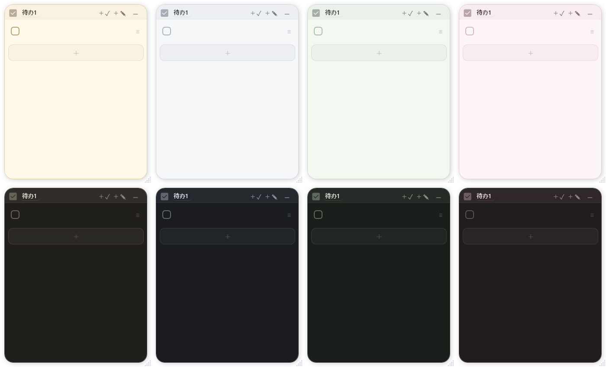
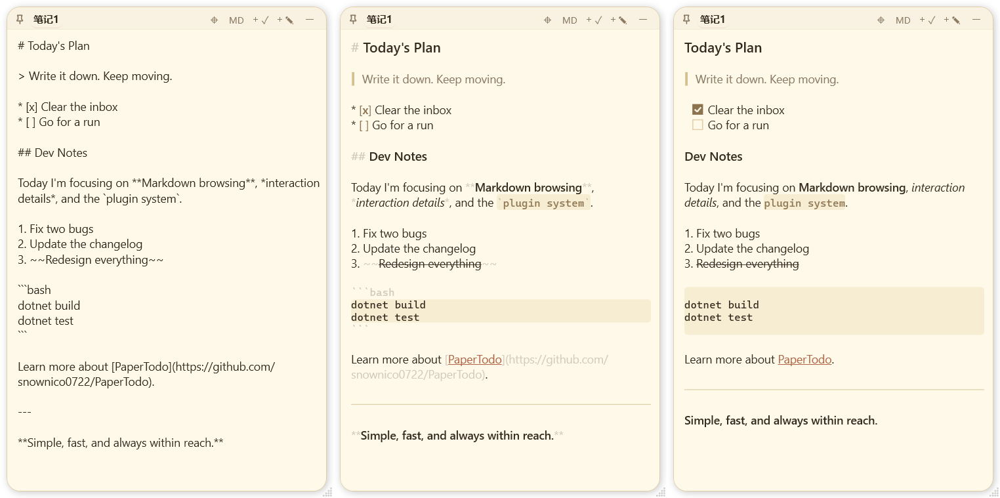
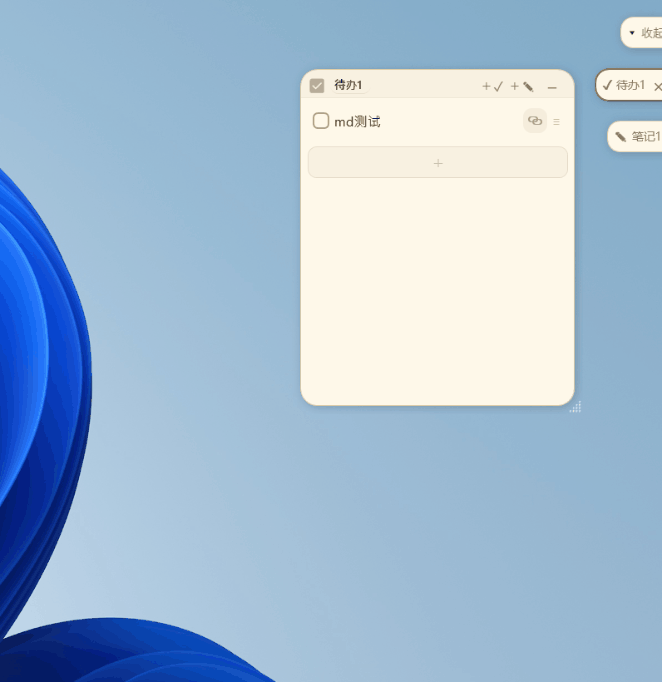
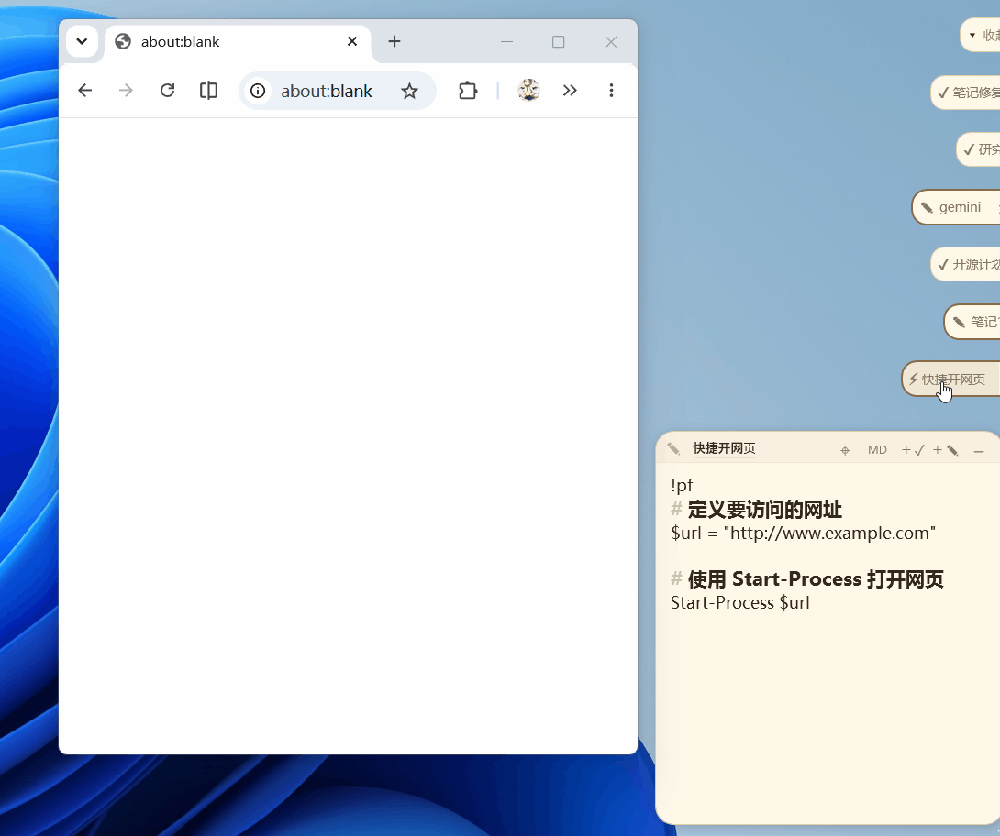
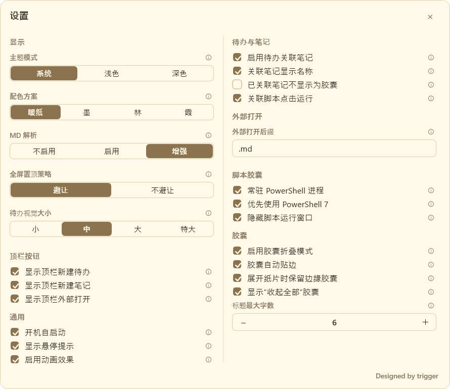

# PaperTodo 用户手册

**语言：简体中文 | [English](USER_GUIDE.en.md)**

> **相关链接**：[返回项目主页](../README.zh.md) · [插件开发文档](../plugin-samples/README.zh.md) · [版本更新日志](../CHANGELOG.zh.md)
>
> 本手册按 **当前主线** 维护，包含更新日志「Unreleased / 未发布」中的功能；已发布的 4.0.0-beta1 或旧安装包不一定具备全部功能，请对照所用版本的更新日志。截图用于说明基本操作，设置布局以实际版本为准。

本文档面向 PaperTodo 的日常使用者。如果你是第一次接触 PaperTodo，请先阅读 [1. 快速入门](#1-快速入门)；其余章节可在需要时按目录检索查阅。

---

## 目录

- [1. 快速入门](#1-快速入门)
  - [1.1 安装与版本选择](#11-安装与版本选择)
  - [1.2 首次启动与界面理念](#12-首次启动与界面理念)
  - [1.3 三分钟上手第一张纸](#13-三分钟上手第一张纸)
- [2. 纸片通用操作](#2-纸片通用操作)
  - [2.1 纸片形态：展开与胶囊](#21-纸片形态展开与胶囊)
  - [2.2 顶栏交互功能](#22-顶栏交互功能)
  - [2.3 移动、缩放与 Windows 分屏贴靠](#23-移动缩放与-windows-分屏贴靠)
  - [2.4 概念辨析：折叠、隐藏、删除与退出](#24-概念辨析折叠隐藏删除与退出)
  - [2.5 全文搜索](#25-全文搜索)
  - [2.6 导出待办与笔记](#26-导出待办与笔记)
- [3. 待办纸（Todo）完全指南](#3-待办纸todo完全指南)
  - [3.1 添加与编辑事项](#31-添加与编辑事项)
  - [3.2 排序、删除与批量处理](#32-排序删除与批量处理)
  - [3.3 完成项整理机制](#33-完成项整理机制)
  - [3.4 快速启动：关联纸片与本地文件](#34-快速启动关联纸片与本地文件)
  - [3.5 定时倒计时提醒](#35-定时倒计时提醒)
- [4. 笔记纸（Note）完全指南](#4-笔记纸note完全指南)
  - [4.1 编辑态与浏览态](#41-编辑态与浏览态)
  - [4.2 Markdown 语法支持一览](#42-markdown-语法支持一览)
  - [4.3 本地图片插入与管理](#43-本地图片插入与管理)
  - [4.4 外部编辑器临时打开](#44-外部编辑器临时打开)
- [5. 边缘胶囊与实时预览卡片（Edge Preview）](#5-边缘胶囊与实时预览卡片edge-preview)
  - [5.1 边缘胶囊与自动停靠](#51-边缘胶囊与自动停靠)
  - [5.2 实时悬停预览卡片（可交互）](#52-实时悬停预览卡片可交互)
  - [5.3 多显示器换边与队列排序](#53-多显示器换边与队列排序)
  - [5.4 主胶囊（队列控制器）](#54-主胶囊队列控制器)
- [6. 进阶玩法：脚本胶囊（PowerShell）](#6-进阶玩法脚本胶囊powershell)
  - [6.1 脚本胶囊声明语法](#61-脚本胶囊声明语法)
  - [6.2 触发运行与常驻进程](#62-触发运行与常驻进程)
  - [6.3 安全须知](#63-安全须知)
- [7. 快捷键完全速查表](#7-快捷键完全速查表)
  - [7.1 纸片内置快捷键](#71-纸片内置快捷键)
  - [7.2 全局快捷键](#72-全局快捷键)
  - [7.3 侧边胶囊快速启动（1~9）](#73-侧边胶囊快速启动19)
- [8. 设置项全景说明](#8-设置项全景说明)
  - [8.1 基础行为](#81-基础行为)
  - [8.2 视觉外观（背景与字体）](#82-视觉外观背景与字体)
  - [8.3 快捷键设置](#83-快捷键设置)
  - [8.4 插件系统使用指南](#84-插件系统使用指南)
  - [8.5 实验室功能（4.0 深度进阶）](#85-实验室功能40-深度进阶)
  - [8.6 工作区](#86-工作区)
- [9. 托盘菜单与命令行启动参数](#9-托盘菜单与命令行启动参数)
  - [9.1 托盘菜单详解](#91-托盘菜单详解)
  - [9.2 命令行启动参数（CLI）](#92-命令行启动参数cli)
- [10. 数据备份、迁移与恢复](#10-数据备份迁移与恢复)
  - [10.1 目录结构与数据文件说明](#101-目录结构与数据文件说明)
  - [10.2 数据备份流程](#102-数据备份流程)
  - [10.3 跨电脑迁移与异常恢复](#103-跨电脑迁移与异常恢复)
- [11. 常见问题解答（FAQ）](#11-常见问题解答faq)

---

## 1. 快速入门

### 1.1 安装与版本选择

GitHub 提供 PaperTodo 的 Windows x64 便携版，可从 [Releases 页面](https://github.com/snownico0722/PaperTodo/releases) 下载。以下文件放置与迁移步骤按便携版说明；下载时查看对应版本的更新日志，主线「未发布」功能需等待包含它们的新版本。

| 版本文件名标识 | 特点 | 适用场景 |
| :--- | :--- | :--- |
| `self-contained.exe` | 自包含 .NET 运行时 | **推荐绝大多数用户下载**，无需额外安装运行时 |
| `no-runtime.exe` | 不含 .NET 运行时；文件大小以下载页为准 | 系统已安装 **.NET 10 Desktop Runtime (x64)** |

> [!IMPORTANT]
> 请在电脑硬盘中建立一个专门的目录（例如 `D:\Apps\PaperTodo\`），并将 `PaperTodo.exe` 置于其中运行。
> **切勿**将程序放在临时解压目录或只读目录下运行，否则可能无法保存数据与图片。更新程序前先从托盘退出，并保留原有数据文件。

### 1.2 首次启动与界面理念

双击运行 `PaperTodo.exe` 后：

- 桌面中央会出现一张默认的待办纸；
- Windows 任务栏通知区（托盘区）常驻 PaperTodo 图标。

**PaperTodo 没有传统的中心主窗口。** 每一张纸片就是软件的独立操作界面，托盘图标则是全局管理入口。若桌面上的纸片被遮挡或移出屏幕，可**双击托盘图标**召回纸片。

每个工作区最多保留 **200 张纸片**。折叠或隐藏不会删除纸片，也不会释放数量名额；不再需要的纸片应通过删除操作移除。

### 1.3 三分钟上手第一张纸

1. **输入待办**：在默认待办纸的空白输入区键入事项，按 <kbd>Enter</kbd> 在下方继续添加。
2. **勾选完成**：点击行左侧复选框，文字出现删除线。
3. **摆放纸片**：按住顶栏空白处拖动；点击图钉切换置顶。
4. **折叠胶囊**：点击右上角按钮。启用胶囊与贴边模式后，纸片会折叠到屏幕边缘。
5. **查看或展开**：启用边缘实时预览后，悬停即可浏览内容；点击胶囊可打开完整纸片。

编辑内容会自动保存，无需点击“保存”。想找另一张纸上的内容，可按 <kbd>Ctrl</kbd> + <kbd>F</kbd>，见 [全文搜索](#25-全文搜索)。

---

## 2. 纸片通用操作

<div align="center">
  
</div>

### 2.1 纸片形态：展开与胶囊

每张纸片均具备两种存在形态：

- **展开态**：正常便签窗口，供用户阅读、编辑、打勾、贴图。
- **胶囊态**：折叠后的药丸状小浮标，可吸附在屏幕边缘或悬浮在桌面上。

点击右上角折叠按钮、按 <kbd>Ctrl</kbd> + <kbd>W</kbd>，或在顶栏空白处单击**鼠标中键**，均可收起当前展开的纸片。关闭胶囊模式时，同一操作会隐藏纸片，而不是删除内容。

### 2.2 顶栏交互功能

| 控件 / 操作 | 使用方法 |
| :--- | :--- |
| **图钉** | 切换当前纸片置顶；全屏时可按设置避让 |
| **标题** | 点击编辑；Enter 提交，Esc 取消。默认上限为 6 个全角字符宽度，英文、数字等半角字符按半个计算 |
| **`···` 菜单** | 打开纸片操作菜单，也可从纸片右键入口打开；在此查找未固定到顶栏的快捷操作、导出和设置 |
| **关联拖拽** | 按住拖到待办项以关联当前纸片；启用外部窗口绑定后，也可拖到第三方窗口 |
| **切换工作区** | 启用多个工作区后使用；默认切到下一个，也可设置为按名称选择 |
| **新建待办 / 笔记** | 创建新纸片 |
| **外部编辑** | 内置 Markdown 笔记可临时导出后用外部程序打开，见 [4.4](#44-外部编辑器临时打开) |
| **折叠 / 隐藏** | 收起纸片；关闭胶囊模式时隐藏纸片 |

在“设置 → 常规 → 顶栏快捷”拖动五项内置操作，在“显示在顶栏”和“显示在菜单”之间移动并排序。待办与笔记共用一套配置，不适用的操作不会显示。

新安装默认将关联拖拽、工作区切换放在顶栏，新建笔记、新建待办和外部编辑放在菜单；升级保留已有配置。顶栏太窄时，已固定的内置快捷会整组临时移入菜单。关联拖拽在菜单中同样可以按住拖出。插件也可能提供顶栏按钮，例如 Codex 的 `>_`。

### 2.3 移动、缩放与 Windows 分屏贴靠

- **移动纸片**：按住顶栏没有按钮的空白区域拖动。
- **调整尺寸**：拖拽右下角把手，也可从纸片可见的四边或四角拖拽。“设置 → 视觉”的标准 / 柔和 / 隐藏只改变把手外观，不影响边缘缩放。
- **Windows 分屏贴靠**：拖动展开纸片贴近屏幕边缘，可触发 Windows 贴靠布局；贴靠时收起外围阴影，离开后恢复。

### 2.4 概念辨析：折叠、隐藏、删除与退出

| 操作 | 纸片去向 | 数据保留情况 | 如何找回 / 恢复 |
| :--- | :--- | :--- | :--- |
| **折叠** | 缩小为屏幕边缘或桌面的胶囊 | 完整保留 | 单击胶囊重新展开 |
| **隐藏** | 退出桌面与胶囊队列，程序仍在后台 | 完整保留 | 从托盘列表显示，或双击托盘召回 |
| **删除** | 纸片彻底移除 | 内容被删除 | 删除前需要确认；不能当作普通隐藏使用 |
| **退出** | 保存数据并关闭 PaperTodo 进程 | 完整保留在磁盘 | 重新运行 `PaperTodo.exe` |

### 2.5 全文搜索

在待办纸或笔记纸中按 <kbd>Ctrl</kbd> + <kbd>F</kbd> 打开搜索栏，输入要查找的文字。

- 搜索覆盖**当前工作区**的全部待办与内置 Markdown 笔记，并分别显示**当前纸片**和**全局**匹配计数；其他工作区需切换后搜索。
- 按 <kbd>Enter</kbd> 查找下一处，<kbd>Shift</kbd> + <kbd>Enter</kbd> 查找上一处，也可点击搜索栏的导航按钮。
- 命中其他纸片时会自动定位并高亮；对应纸片处于胶囊状态时会自动展开。
- 搜索栏可以拖动，避免挡住正在查看的内容。查找结束后关闭搜索栏即可继续编辑。

### 2.6 导出待办与笔记

打开待办纸或内置 Markdown 笔记的 `···` / 纸片右键菜单，选择导出当前纸片或“导出全部纸片”，再在保存对话框中选择格式。

| 导出方式 | 保存内容 |
| :--- | :--- |
| 当前纸片 → Markdown | `.md` 文件；笔记需要时附带图片文件夹，分享时一并保留 |
| 当前纸片 → HTML | `.html` 文件；笔记图片嵌入文件，可用浏览器打开 |
| 全部纸片 → Markdown / HTML | ZIP 压缩包，包含**当前工作区**所有待办与内置 Markdown 笔记 |

待办导出保留顺序、完成状态和多行正文，略过空白输入占位行。插件正文不在此导出范围内。导出在后台进行，可继续编辑；完成后检查结果提示，缺失图片会使用文字占位并给出警告。

导出用于阅读、分享或交给其他编辑器，不是完整数据备份；迁移工作区、设置与插件数据请按 [第 10 章](#10-数据备份迁移与恢复) 操作。

---

## 3. 待办纸（Todo）完全指南

待办纸专为日常清单、日程安排与零碎任务设计。

### 3.1 添加与编辑事项

- **新建项**：点击空白行输入；按 Enter 在下方插入新待办。
- **同一项内换行**：按 Shift+Enter。Enter 仍用于新建事项，两者用途不同。
- **修改与双击选中**：单击文字编辑；双击可选中该项文字。
- **长待办折叠**：显示超过四行时，点击右侧拖动手柄上方的小箭头，收起至两行或展开。省略号仅为显示效果；进入编辑会显示完整原文。
- **查找折叠正文**：命中折叠后不可见的文字时，高亮该项及展开图标，不自动展开；需要时点击箭头查看。
- **跨项编辑**：用 ↑ / ↓ 在当前项的编辑边界进入相邻待办；长按不会连续跳过多条事项。
- **删除空白行**：在未做标记的空白行按 Backspace。
- **多行粘贴**：粘贴的多行文字会处理列表符号、编号和 Markdown 任务框，并拆成独立事项；不会因为支持 Shift+Enter 就自动合成一条。出现数量或长度截断提示时，请检查哪些内容没有插入。
- **撤销与重做**：Ctrl+Z / Ctrl+Y；一次多行粘贴作为一次操作撤销。

### 3.2 排序、删除与批量处理

- **拖拽排序**：按住右侧手柄（`≡`）上下拖动；多选后可整组移动，并保持组内顺序。
- **拖动时滚动**：靠近列表上下边缘会自动滚动，鼠标停住也会继续。垃圾桶出现删除预选时仍可滚动；拖离垃圾桶即可取消预选，只有在垃圾桶内松手才删除。
- **连续滑动多选**：从事项左侧按住鼠标左键滑动，连续选中多条。
- **批量处理**：可批量完成 / 恢复、复制、右键删除，或整组拖入垃圾桶。
- **保留完成状态复制**：Ctrl+Shift+C 将多选项复制为 `- [ ] 未完成` / `- [x] 已完成` 的 Markdown 任务列表；普通复制使用 Ctrl+C。
- **底部栏开关**：在“设置 → 待办”关闭底部快捷添加栏后，拖入垃圾桶删除也会停用；仍可使用右键删除。

### 3.3 完成项整理机制

在“设置 → 待办”选择完成项的处理方式：

- **完成后自动清除待办**：勾选后从列表移除；误操作可用撤销恢复。
- **已完成待办自动置底**：勾选后移至底部已完成区域；取消勾选则回到未完成区域。

开启自动清除时，自动置底选项不可用。

### 3.4 快速启动：关联纸片与本地文件

一条待办还可以作为纸片、文件或文件夹的快捷入口。相关开关位于“设置 → 待办”。

#### 关联另一张纸片

1. 展开要关联的目标纸片。
2. 将目标纸片的**关联拖拽**按钮拖到一条待办上，看到高亮后松开；按钮收纳在 `···` 菜单时，也可按住菜单中的关联项拖出。
3. 点击待办右侧出现的纸片图标，即可展开目标纸片。若关联纸片不进入胶囊队列，启用“再次点击胶囊收起纸片”后，再次点击此关联入口也可收回已展开的纸片。

#### 关联外部文件或文件夹

1. 在 Windows 文件资源管理器中选中文件或文件夹。
2. 拖到目标待办行上松开。
3. 点击右侧入口，用系统默认程序打开；右键该项可打开所在文件夹或取消关联。

### 3.5 定时倒计时提醒

先在“设置 → 待办”启用**待办提醒**，再右键事项设置提醒。

- **快捷预设**：选择分钟 / 小时间隔、当天傍晚或次日早晨等时间。
- **自定义时长**：输入需要的倒计时时长。
- **到期提示**：自动定位并高亮事项，发送托盘通知；需要声音时，在提醒设置中开启提示音并选择声音。

提醒依赖 PaperTodo 运行及当前工作区处于活动状态；切走的工作区不持续运行提醒。安装了接管提醒的插件时，该次提示可能由插件呈现。声音设置也支持程序旁的 `papertodo.wav`，有效时优先于所选系统声音。

---

## 4. 笔记纸（Note）完全指南

<div align="center">
  
</div>

笔记纸专为轻量记录、灵感随笔与图文备忘设计。

### 4.1 编辑态与浏览态

在“设置 → 笔记 → Markdown”选择渲染档位：

| 档位 | 使用方式 |
| :--- | :--- |
| **关闭** | 主要按纯文本查看、编辑 Markdown 源码 |
| **基础** | 保留源码标记并提供基础样式；浏览时淡化语法、显示列表圆点与分割线 |
| **完全渲染** | 标题、列表、引用、代码块、图片与行内样式直接排版，**编辑时也保持渲染** |

- **进入编辑**：点击正文定位光标。完全渲染下不是整篇切回纯文本；编辑到相关标记时，会显示对应源码，便于修改语法。
- **进入浏览**：点击纸片外部使其失去焦点；笔记按所选档位展示。
- **链接交互**：浏览时直接点击链接；编辑时按住 <kbd>Ctrl</kbd> 再点击。
- **正文字号缩放**：<kbd>Ctrl</kbd> + 滚轮调整；点击右下角比例恢复 100%。
- **复制纯文本**：选中文字后按 <kbd>Ctrl</kbd> + <kbd>Shift</kbd> + <kbd>C</kbd>。

#### 直接勾选 Markdown 任务框

在笔记中输入：

```markdown
- [ ] 整理资料
- [x] 发送邮件
```

切换到**完全渲染**后，直接点击渲染出的方框即可完成或取消完成，无需手动修改 `[ ]` / `[x]`。编辑态和浏览态都支持；当标记正在显示为源码时，先移开光标使方框恢复显示。勾选会更新笔记内容，也支持撤销。

> [!NOTE]
> 笔记仍有输入保护上限。达到限制时会给出提示；长内容可拆成多张纸片，不要依赖反复粘贴绕过提示。

### 4.2 Markdown 语法支持一览

| 语法格式 | 示例写法 | 显示效果 |
| :--- | :--- | :--- |
| **标题** | `# 一级标题` / `## 二级标题` / `### 三级标题` | 分级标题 |
| **加粗** | `**粗体文字**` | **粗体文字** |
| **斜体** | `*斜体文字*` | *斜体文字* |
| **粗斜体** | `***重要强调***` 或 `___重要强调___` | ***重要强调*** |
| **删除线** | `~~已作废内容~~` | ~~已作废内容~~ |
| **无序列表** | `- 第一项` 或 `* 第一项` | 圆点列表 |
| **有序列表** | `1. 第一步`、`2. 第二步` | 编号列表 |
| **任务列表** | `- [ ] 未完成` / `- [x] 已完成` | 完全渲染下可直接勾选 |
| **引用块** | `> 这是一段引用` | 引用段落 |
| **行内代码** | `` `console.log()` `` | 等宽代码 |
| **代码块** | <code>```<br>代码内容<br>```</code> | 独立代码块 |
| **超链接** | `[说明文字](https://example.com)` | 可点击链接 |
| **分割线** | `---` 或 `***` | 水平分割线 |
| **反斜杠转义** | `\*不作为斜体\*` | 按普通字符显示星号 |

粗体、斜体、删除线与链接可以组合使用。4.0 统一了标题、引用、列表、代码围栏、简单 HTML、转义与图片所在代码区的解析，复杂嵌套时显示和编辑更一致。

> [!NOTE]
> PaperTodo 保持轻量，不提供复杂表格、远程图床图片、附件嵌入或完整块级 HTML 排版。需要复杂排版时，可使用外部编辑器。

### 4.3 本地图片插入与管理

- 截图或复制图片后，在笔记中按 <kbd>Ctrl</kbd> + <kbd>V</kbd>。
- 从资源管理器拖入一张或多张图片。
- 右键笔记正文，选择“插入图片”。

图片以 Markdown 图片引用出现在正文中，实际数据保存在当前工作区的图片库：主工作区为 `note-assets.lmdb`，工作区 2～5 分别为 `note-assets2.lmdb`～`note-assets5.lmdb`。右键已渲染图片可复制图片或删除引用。迁移时应同时保留同一工作区的文字数据和图片库。

**MCP 图片操作**：启用 MCP 并允许新增/追加写入后，可将图片**追加到现有内置 Markdown 笔记末尾**。图片仍按现有格式、压缩、尺寸与图片库容量限制保存；返回图片 ID 和 Markdown 引用。

- **本地 Codex 等可执行程序的客户端**：运行 `PaperTodo.exe --import-note-image --paper-id <笔记ID> [--image-name <名称>]`，由调用端程序将原始图片字节写入子进程的二进制标准输入，完成后关闭输入。最多 4 MiB；命令不接受图片文件路径、网址、Base64 文本或 data URI。程序会自行编码并调用既有写入通道，模型只接收简短结果。
- **能直接用代码调用 MCP 的客户端**：由程序构造 `insert_note_image(paper_id, image_base64=图片数据)`，使用纯 Base64（解码后最多 4 MiB，可选 `image_name`）。不要先把编码打印进对话，再让模型复制到工具参数。
- **只支持普通工具调用的聊天客户端**：须由客户端提供附件字节转交能力；仅把图片展示给模型，不代表能转交原图。

调用示例（Python 标准库；原图已在内存时直接使用已有的 `image_bytes`）：

```python
from pathlib import Path
import subprocess

image_bytes = Path(r"C:\Pictures\screenshot.png").read_bytes()  # 调用端读取
result = subprocess.run(
    [r"C:\PaperTodo\PaperTodo.exe", "--import-note-image",
     "--paper-id", "替换为已有笔记ID", "--image-name", "screenshot.png"],
    input=image_bytes, capture_output=True, check=False,
)
print(result.stdout.decode("utf-8"))  # 只有简短 JSON，不含图片数据
if result.returncode:
    raise RuntimeError(result.stderr.decode("utf-8", errors="replace"))
```

PowerShell 调用时请使用 `Process.StandardInput.BaseStream` 写入字节，不要用文本管道传图片。退出码 `0` 表示成功，`1` 表示导入失败，`2` 表示参数或输入方式错误；失败信息写入标准错误。命令不会自行打开主界面或启用 MCP 权限；主程序须已经运行。接收图片期间若切换工作区，导入会被拒绝；写入结果不明时先查询笔记，避免重复追加。

读取时，先用 `get_paper` 找到 `i:图片ID`，再用 `read_note_image(paper_id, image_id)` 获取支持视觉的 MCP 客户端可直接查看的图片；不可跨笔记读取别的笔记的图片。读取仅允许当前笔记正文仍有效引用的图片；删除引用后，即使为撤销恢复保留了图片字节，MCP 也不能再读取。追加图片前会检查当前 Markdown 排版；例如末尾有未闭合的代码块时会拒绝写入，以免出现导入成功却只显示图片代码的情况。读取不需要写入权限；实际能否显示图片，取决于 MCP 客户端是否支持图片内容块。

### 4.4 外部编辑器临时打开

从纸片 `···` 菜单选择**外部编辑**；也可在顶栏快捷设置中将它固定到顶栏。此操作将当前内置 Markdown 笔记和引用图片导出到临时文件，再用系统关联程序打开。“设置 → 笔记”可调整文件后缀；没有关联程序时使用记事本。

> [!NOTE]
> 外部打开是单向导出。在外部编辑器保存的修改**不会自动写回 PaperTodo**，需要手动复制回纸片。需要长期保存或分享文件时，使用 [导出待办与笔记](#26-导出待办与笔记)。

---

## 5. 边缘胶囊与实时预览卡片（Edge Preview）

<div align="center">
  
</div>

### 5.1 边缘胶囊与自动停靠

在“设置 → 常规”启用胶囊与贴边模式后，纸片可折叠到屏幕左侧或右侧。点击边缘胶囊打开完整纸片。

- **再次点击**：启用对应选项并保留展开后的边缘入口时，纸片仍明显可见则收回；被其他窗口明显遮挡时，优先将它带回前台。
- **标题长度**：高级设置可限制边缘胶囊标题长度，也可选择**完全隐藏**或**不限长度**。
- **标题滑动展开**：关闭边缘实时预览后，截短标题可在悬停时滑动展开到完整长度，移开后收回；不只是露出关闭按钮所在的尾部。
- **关闭按钮**：隐藏关闭按钮后不再保留它的空位。

### 5.2 实时悬停预览卡片（可交互）

启用边缘实时预览后，将鼠标移到边缘胶囊即可查看卡片，无需打开完整纸片。

- **待办预览**：显示简化列表，可滚动浏览、直接勾选或取消完成；关联纸片和文件有独立点击区域。点击卡片背景打开完整纸片。
- **笔记预览**：跟随笔记 Markdown 渲染，支持最多 **6000 字符**的预览。更长的内容请打开完整纸片，预览范围不会截断原笔记。
- **连续浏览**：沿相邻胶囊移动时，卡片连续切换；可调节鼠标意图预测，减少误切换。离开浏览区域后自动收回。
- **向下展开**：“设置 → 常规 → 浏览时优先向下展开”默认开启。下方空间足够时保持鼠标附近的位置，不为了补上方空位而跳动；关闭后优先利用上一张卡片释放的上方空间。
- **拖拽保护**：开始拖动胶囊时预览收回，不占用排序或换边手势。

### 5.3 多显示器换边与队列排序

- **换边停靠**：将胶囊拖到屏幕另一侧或另一块显示器边缘。
- **调整顺序**：在同侧队列中上下拖动胶囊。
- **记住展开位置**：启用该选项后，完整纸片可记住不同于胶囊所在屏幕的位置；支持不同缩放比例的显示器。

### 5.4 主胶囊（队列控制器）

队列顶端的主胶囊用于控制整队：

- **统筹收放**：单击收缩或展开这一侧的胶囊入口，不会删除纸片。
- **调节高度**：上下拖动，调整整条队列的起始高度。
- **整队换屏 / 换边**：横向拉出主胶囊后，队列临时收起；拖到目标显示器的左侧或右侧松手，整队迁移并保持原有顺序。不在队列中的隐藏纸片或展开纸片不随之搬移。
- **全局菜单**：右键打开全局菜单。
- **精简外观**：常规的高级选项可隐藏数量，只保留箭头。

“设置 → 常规”也可取消贴边胶囊和主胶囊的强制置顶。

---

## 6. 进阶玩法：脚本胶囊（PowerShell）

<div align="center">
  
</div>

笔记纸可以用作随手可点的 PowerShell 脚本入口。

### 6.1 脚本胶囊声明语法

在笔记**第一行**写入指令前缀，后面写脚本：

```powershell
!p
Get-Service | Where-Object Status -eq 'Running' | Select-Object -First 5
```

| 指令前缀 | 运行机制说明 |
| :--- | :--- |
| `!p` 或 `!power` | 自动选择 PowerShell，执行出错时提示 |
| `!pwsh` 或 `!ps7` | 使用已安装的 PowerShell 7 |
| `!ps5` 或 `!winps` | 使用 Windows PowerShell 5.1 |
| `!pf` 或 `!powerf` | 启用常驻进程后复用会话，保留变量与环境 |

### 6.2 触发运行与常驻进程

- 折叠后显示**闪电图标**；左键单击脚本胶囊会运行脚本，而不是展开纸片。
- 修改代码时，右键胶囊选择“展开纸片”。
- 常驻进程、优先使用 PowerShell 7、隐藏运行窗口等选项位于高级模式下的“设置 → 笔记”。

### 6.3 安全须知

> [!CAUTION]
> 脚本以 PaperTodo 当前进程的权限运行。不要执行来源不明、未经检查的脚本。

---

## 7. 快捷键完全速查表

### 7.1 纸片内置快捷键

| 快捷键 | 作用范围 | 功能说明 |
| :--- | :--- | :--- |
| <kbd>Ctrl</kbd> + <kbd>F</kbd> | 待办 / 笔记 | 搜索当前工作区的待办与内置笔记 |
| <kbd>Enter</kbd> / <kbd>Shift</kbd> + <kbd>Enter</kbd> | 待办编辑 | 新建事项 / 同一项内换行 |
| <kbd>Enter</kbd> / <kbd>Shift</kbd> + <kbd>Enter</kbd> | 搜索栏 | 下一处 / 上一处命中 |
| <kbd>Ctrl</kbd> + <kbd>W</kbd> | 通用 | 收起当前纸片；关闭胶囊模式时隐藏 |
| <kbd>Esc</kbd> | 通用 | 取消当前编辑、选择或拖拽等状态；空闲时收起纸片 |
| <kbd>Ctrl</kbd> + <kbd>Z</kbd> / <kbd>Y</kbd> | 待办 / 笔记 | 撤销 / 重做 |
| <kbd>Ctrl</kbd> + <kbd>Shift</kbd> + <kbd>C</kbd> | 待办多选 | 复制为保留完成状态的 Markdown 任务列表 |
| <kbd>Ctrl</kbd> + <kbd>Shift</kbd> + <kbd>C</kbd> | 笔记选区 | 复制为纯文本 |
| <kbd>↑</kbd> / <kbd>↓</kbd> | 待办编辑 | 在编辑边界切换相邻事项 |
| <kbd>Ctrl</kbd> + <kbd>B</kbd> / <kbd>I</kbd> / <kbd>K</kbd> | 笔记 | 加粗 / 斜体 / 插入链接 |
| <kbd>Ctrl</kbd> + 滚轮 | 笔记 | 缩放正文；点击比例复位 |

插件可提供自己的快捷键，也可接管其正文内的 <kbd>Esc</kbd>，以插件说明为准。

### 7.2 全局快捷键

在“设置 → 快捷键”录制组合键，可在其他程序获得焦点时使用：

- 显示全部 / 隐藏全部 / 切换显隐，新建待办 / 笔记，退出程序。
- 锁定全部纸片。
- 切换全部纸片或当前纸片透明度，切换全部胶囊透明度。
- 将纸片或胶囊置底。

部分动作对应实验室功能，需先按设置启用。录制时可使用 <kbd>Ctrl</kbd>、<kbd>Alt</kbd>、<kbd>Shift</kbd>、<kbd>Win</kbd> 与普通按键组合；若提示被占用，请换一组按键。

### 7.3 侧边胶囊快速启动（1~9）

开启侧边胶囊快速启动后，可通过对应编号呼出纸片。默认左侧为 <kbd>Ctrl</kbd> + <kbd>Shift</kbd> + <kbd>1~9</kbd>，右侧为 <kbd>Ctrl</kbd> + <kbd>Alt</kbd> + <kbd>1~9</kbd>。“区分小键盘数字键”设置适用于普通全局快捷键，不改变侧边胶囊快速启动序列。

---

## 8. 设置项全景说明

右键托盘选择“设置”。4.0 使用**左侧导航**，常用页面为常规、工作区、待办、笔记、视觉、快捷键、插件；开启“高级模式”后显示额外选项和实验室页面。

设置窗口会适应当前屏幕工作区、缩放和跨屏移动；开关与快捷键录制尽量局部刷新。各项说明图标可查看详细提示。

<div align="center">
  
</div>

### 8.1 基础行为

- **常规**：开机启动、提示、动画、语言、顶栏快捷和胶囊行为。“快速动画”缩短过渡时间，默认关闭，不影响提醒计时；高级模式可调整任务栏 / Alt+Tab 显示及全屏避让。语言修改后需要重启。
- **待办**：底部快捷添加栏、完成后自动清除 / 置底、纸片与文件关联、提醒及其声音。
- **笔记**：Markdown 三档渲染、完全渲染编辑动画、外部打开后缀；高级模式还有大图压缩与脚本胶囊设置。

Markdown 的使用差异见 [4.1](#41-编辑态与浏览态)。基础档仍保留源码；要在编辑时看到完整排版并直接勾选任务框，请选完全渲染。

### 8.2 视觉外观（背景与字体）

- **主题与配色**：跟随系统、浅色、深色；内置暖纸、墨、林、霞。
- **皮肤**：默认纸片、标准云母、标准亚克力、透色亚克力、半透明描图纸、Aero 和像素风，可分别定制配色。
- **原生材质**：需要 Windows 11 22H2 或更新版本；首次启用时按提示退出重开。系统不支持或关闭透明效果时，外观可能回退为实色。
- **材质透明度**：五档调整展开纸片和设置窗口的材质效果，不会将文字一起变淡；胶囊与菜单仍使用不透桌面的轻量背景。
- **缩放把手**：标准、柔和或隐藏只影响外观，各档均支持拖拽纸片边缘缩放。
- **字体与渲染**：系统默认、微软雅黑、等线；支持标准 / 柔和 / 锐利文字渲染。

#### 自定义纸片背景

1. 准备图片，命名为 `papertodo.png`、`papertodo.jpg` 或 `papertodo.jpeg`，放在 **`PaperTodo.exe` 同目录**，不是 `assets/` 或 `plugins/`。
2. 重新启动程序，在“设置 → 视觉”查看“纸片背景”。检测到图片后才会显示这部分设置。
3. **启用和配色混合**：关闭时显示原图；开启时叠加当前纸片配色。这个开关**不是背景图片的显示开关**。
4. **拉伸**是独立开关：开启后按比例铺满纸片，可能裁掉图片边缘；关闭后小图保持原尺寸，大图仅缩小到完整容纳。
5. **位置**可选居中、左下、正下或右下，用于控制图片对齐。

同一图片用于**笔记和待办**。替换图片后，切换混合、拉伸、位置或重启即可刷新。移除背景时，将这些候选图片移走或改成其他文件名，再重启。多个候选文件同时存在时优先使用 PNG，其次 JPG、JPEG。

解码时最长边限制为 **4096 像素**，不会修改原图片文件。混合、拉伸与位置偏好单独保存在 `%LOCALAPPDATA%\PaperTodo\paper-background.json`，迁移方法见 [数据备份](#102-数据备份流程)。

#### 导入自定义字体教程

1. 准备 `.ttf` 或 `.otf` 字体。
2. 命名为 `papertodo.ttf` 或 `papertodo.otf`，放到程序旁。
3. 可将对应粗体文件命名为 `papertodo_bold.ttf` 放在旁边。
4. 从托盘退出并重启，加载字体。

### 8.3 快捷键设置

点击动作的录入区，按下组合键。界面会检查冲突；“恢复本页默认”也会恢复“小键盘数字键区分”选项。插件注册的快捷键按插件提供的说明配置。

### 8.4 插件系统使用指南

插件可将笔记纸变为时钟、番茄钟或复盘面板，也可添加待办操作、顶栏按钮、菜单、快捷键及专属胶囊 / Mini 预览。当前宿主支持 **插件 API 2.1～2.2**，已有 2.1 插件仍兼容。`plugin.json` 的 `apiVersion` 表示插件要求的最低宿主 API；需要 2.2 的插件不能直接用于较旧宿主。

- **Web 插件**：使用 WebView2 运行 HTML/CSS/JavaScript。
- **Native 插件**：以 .NET 10 + WPF 编译运行。
- **插件数据**：配置入口位于“设置 → 插件”；宿主管理的数据按工作区分别位于 `plugins/data/`、`plugins/data2/`～`plugins/data5/`。数据分开存放不等于权限隔离。插件自行保存到其他位置的文件，按该插件说明另行备份。

#### 插件安装与启用步骤

1. 获取完整的可运行插件目录。仓库的 [`plugins/`](../plugins/) 放成品；[`plugin-samples/`](../plugin-samples/) 放源码和开发说明，**Native 源码不能直接当成插件成品复制使用**。主程序发布包不捆绑这些插件。
2. 从托盘退出 PaperTodo。
3. 将完整目录放到程序旁的 `plugins/<插件 ID>/`，目录名须与 `plugin.json` 的 `id` 一致；`plugin.json` 应直接位于这一层，而不是多套一层文件夹。
4. 重启后在“设置 → 插件”确认识别情况。
5. 对提供正文的插件，右键笔记纸，在“正文类型”中选择它；部分插件会按自身设置自动创建入口纸片。

更新、移除插件文件后同样需要重启，不支持直接替换 Native DLL 后热加载。

> [!WARNING]
> PaperTodo **不为插件提供安全沙箱**。Native 与 Web 插件都应按可信代码对待，只安装可信来源。插件的数据目录不是限制其系统访问权限的安全边界。
>
> 开发者可查阅 [插件开发手册](../plugin-samples/README.zh.md)。

#### 示例插件与 Codex CLI Bridge

可运行示例包括原生时钟、专注番茄钟、复盘记录池、Web 时钟和 **Codex CLI Bridge**。从成品目录选择所需插件即可，不必复制全部插件。

Codex CLI Bridge 需要本机已安装并登录 Codex CLI：

- 待办右侧的 `Codex` / `>_` 发送当前事项及其关联纸片、文件路径或支持的图片；纸片顶栏的 `>_` 发送当前待办 / 内置笔记全文。
- 两种入口都**默认打开前台 PowerShell 窗口**，结束后保留窗口以便查看结果。开启插件的“后台执行”后，两种入口才改为静默执行。
- 提示词纸片启动时默认隐藏。从“设置 → 插件 → Codex CLI Bridge → 更多设置 → 编辑提示词”打开；删除最后一张该插件纸片会撤下它的全局按钮，隐藏不会。
- 模型默认 `gpt-6-astra`，推理默认 `xhigh`；留空可沿用本机 Codex 对应配置。界面和未编辑的默认提示词随软件语言变化，已编辑的提示词不会因此被替换。
- “开启插件技能”“开启本软件操作技能”“允许本插件开启 MCP”是三个独立开关，默认均开启。前两个决定任务附带的操作指引。
- **允许本插件开启 MCP**：任务需要时，允许开启 MCP 总开关及新增、写入、直接删除、敏感设置控制等权限。取消此项阻止后续自动开启，**不会自动撤销此前已经开启的权限**；需要时在实验室中另行关闭。

它沿用本机 Codex 的登录、审批和沙箱配置，不是 PaperTodo 自带的免费 AI 服务。模型、推理、命令路径、工作目录及提示词详见 [Codex CLI Bridge 说明](../plugin-samples/PaperTodo.Plugin.CodexCliBridge/README.md)。

### 8.5 实验室功能（4.0 深度进阶）

开启“高级模式”后，在实验室选择需要的能力：

- **本地 MCP**：开启对应功能与授权，复制客户端配置和 AI Skill 提示词，在支持 MCP 的客户端中使用。客户端以 `PaperTodo.exe --mcp` 启动连接，按授权操作**当前工作区**的纸片、待办、笔记及软件设置。
- **外部窗口绑定**：把顶栏或菜单中的“关联拖拽”入口拖到第三方窗口，使纸片随目标移动、最小化与恢复。
- **边缘磁吸胶囊**：普通浮动胶囊靠近屏幕或外部窗口边缘时吸附，鼠标移入滑出，移开收回；与左右固定队列的贴边模式不是同一个开关。
- **失焦自动化**：失焦后半透明、隐藏标题图标 / 标题栏，或自动收起为胶囊。
- **静置半透明**：普通胶囊与贴边胶囊可分别设置静置透明度。
- **置底与鼠标穿透**：配合全局快捷键，将纸片或胶囊放到其他窗口下方；开启穿透后不会拦截鼠标操作。

MCP 让外部客户端访问你的内容，只给可信客户端所需权限。它可以独立使用；Codex CLI Bridge 也可以只发送内容，操作 PaperTodo 时则可按上述设置接入 MCP。

#### 外部修改数据后重新载入

插件或 MCP 可以显式请求重新载入或合并当前工作区的数据文件：`reload_data` 按磁盘内容替换，可能覆盖尚未保存的本地编辑；`merge_data` 需要外部修改前读取的原始 JSON，才能合并双方独立修改。在“设置 → 常规 → 数据合并冲突”选择询问、优先外部或优先内部；询问模式可对照冲突内容后决定。

这不是文件夹监控。直接修改正在运行的 `data.json` / `dataN.json` 不会自动同步，普通自动保存仍可能覆盖外部改动。需要恢复备份时，请先退出程序，按 [第 10 章](#10-数据备份迁移与恢复) 操作。

### 8.6 工作区

在“设置 → 工作区”启用。默认只有主工作区（1），可新建至最多五个；各自独立保存纸片、布局、图片和插件数据。

- **管理与切换**：点击工作区卡片选择，再点击“确认切换”；名称旁的铅笔用于重命名，对号保存。重命名不会改变数据文件编号。
- **快捷切换**：顶栏或纸片菜单中的工作区入口默认切到下一个。开启“顶栏快捷切换显示具体名称”后，可按名称选择；托盘中也可选择工作区编号并确认。
- **设置跟随**：副工作区默认跟随主工作区的软件设置。此时其他设置页（包括插件页）变灰；到主工作区修改，或在工作区页关闭跟随后独立配置。纸片、布局、图片和插件私有数据不合并。
- **关闭与删除**：关闭工作区功能保留数据；明确删除副工作区会删除其数据，主工作区不能删除。删除前先备份。
- **活动范围**：搜索、“显示全部”、导出全部和通常的 MCP 内容操作都针对当前工作区。切走的工作区不保留运行中的纸片窗口或插件运行实例。

复制备份时要保留所有已用工作区的文件，详见 [数据文件说明](#101-目录结构与数据文件说明)。

---

## 9. 托盘菜单与命令行启动参数

### 9.1 托盘菜单详解

右键 Windows 通知区的 PaperTodo 图标：

- 菜单顶部显示版本。
- 显示 / 隐藏当前工作区的全部纸片，新建待办 / 笔记。
- 启用工作区后，在“工作区”行选择编号，再确认或取消切换。
- 纸片列表显示标题和状态，点击可定位；右侧 `×` 用于确认删除。
- “设置”打开配置；“退出”保存并关闭程序。

### 9.2 命令行启动参数（CLI）

可在快捷方式、批处理或快捷启动器中调用；纸片显隐和新建操作作用于当前工作区：

| 命令行指令 | 等价别名 | 功能执行 |
| :--- | :--- | :--- |
| `PaperTodo.exe --show` | `PaperTodo.exe open` | 显示并召回全部纸片 |
| `PaperTodo.exe --hide` | 无 | 隐藏全部纸片，保留后台运行 |
| `PaperTodo.exe --toggle` | 无 | 切换全部显隐 |
| `PaperTodo.exe --new-todo` | `PaperTodo.exe todo` | 新建待办纸 |
| `PaperTodo.exe --new-note` | `PaperTodo.exe note` | 新建笔记纸 |
| `PaperTodo.exe --exit` | `PaperTodo.exe quit` | 保存并退出 |
| `PaperTodo.exe --mcp` | 无 | 启动供 MCP 客户端使用的连接进程，见实验室说明 |
| `PaperTodo.exe --import-note-image --paper-id <笔记ID>` | 无 | 从二进制标准输入导入图片；主程序须已运行并允许 MCP 新增/追加写入 |

普通界面启动实行单实例：已有 PaperTodo 时，后续启动转发指令后退出，不会重复创建整套窗口。`--mcp` 与 `--import-note-image` 是独立连接模式，不按普通界面启动参数处理。

---

## 10. 数据备份、迁移与恢复

### 10.1 目录结构与数据文件说明

便携版核心数据位于程序目录。每个工作区使用独立文件，编号不会随名称变化：

| 内容 | 主工作区（1） | 副工作区（以 2 为例，3～5 同理） |
| :--- | :--- | :--- |
| 纸片文字、位置与设置 | `data.json` | `data2.json` |
| 短期自动备份 | `data.backup.json` | `data2.backup.json` |
| 笔记图片库 | `note-assets.lmdb` | `note-assets2.lmdb` |
| 宿主管理的插件数据 | `plugins/data/` | `plugins/data2/` |

主 `data.json` 还保存工作区列表、名称等信息，迁移副工作区时也要保留它。插件程序放在 `plugins/<插件 ID>/`，所有工作区共用；历史核心 JSON 压缩包放在 `backups/`。

自定义背景、字体、图标、提醒音等文件也位于程序旁。背景的混合、拉伸与位置偏好另存于 `%LOCALAPPDATA%\PaperTodo\paper-background.json`。

`data.backup.json` 及各副工作区的短期备份不是每次保存都更新，也不保证等于上一笔编辑前的状态。

### 10.2 数据备份流程

1. **从托盘退出，等进程结束后再复制。** 如果报告保存失败，请先处理，不要把仍在运行的程序当作已经安全退出。
2. 最简单的方法是将**整个程序目录**复制到另一处备份位置；这样可同时保留全部工作区、图片库、插件、历史备份及自定义文件。
3. 若选择逐项备份，按上表复制所有已用编号的 JSON、短期备份、图片库和完整 `plugins/`，同时保留主 `data.json`；需要历史恢复点时包含 `backups/`。**只复制无编号的三个文件仅覆盖主工作区。**
4. 另存 `%LOCALAPPDATA%\PaperTodo\paper-background.json`，或迁移后重新配置背景。插件自行存到程序目录外的数据，按该插件说明备份；待办关联的外部文件也不会自动打包。

#### 自动核心数据历史备份

程序在 `backups/` 中保留最多四份 `PaperTodo-core-*.zip`，目标跨度接近最新（约 10 分钟）、6 小时、3 天、1 个月。启动约一分钟后首次检查，此后每十分钟检查一次，与保存和工作区切换独立；内容没变不会重复归档。历史不足时使用较近的恢复点，长期档更新时各档跨度也可能暂时偏离目标。

它只保存已存在的 `data.json`、`data2.json`～`data5.json` 原始内容，**不包含图片、插件数据或短期备份文件**，也不校验 JSON 是否损坏。某个工作区文件暂时不可读时会短暂重试，仍失败则跳过本轮，下轮再尝试；全部不可读时不创建空包。新 ZIP 完整生成后才轮换删除多余历史。恢复前应检查包中实际包含哪些工作区。

> [!IMPORTANT]
> 仅恢复历史 JSON 时，图片可能缺失，也可能因图片编号已被复用而显示错误图片。需要恢复图文时，应使用**同一次完整备份中对应工作区的 JSON 和 LMDB 图片库**。自动 ZIP 和普通内容导出都不能替代完整备份；本地备份也不能抵御整个磁盘损坏。

### 10.3 跨电脑迁移与异常恢复

#### 迁移到新电脑

1. 在旧电脑退出 PaperTodo，按上节建立完整备份。
2. 将整个备份目录复制到新电脑的可写目录，使用与数据、插件兼容的程序版本，恢复完成前不要启动。
3. 按需恢复单独的背景偏好，以及插件自行保存或待办关联的外部文件。
4. 启动后逐个切换已用工作区，检查文字、图片、插件和设置。确认全部正确前保留旧电脑备份。

#### 恢复损坏或误改的数据

1. 退出程序，先完整复制现有目录作为故障备份，保留原始文件。
2. 确定需要恢复的工作区。主工作区可将可用的 `data.backup.json` **复制**为 `data.json`；工作区 2 则将 `data2.backup.json` 复制为 `data2.json`，其他编号同理。不要将副工作区文件覆盖为主 `data.json`。
3. 也可从历史 ZIP 中提取对应编号的 JSON；如需恢复图片或插件状态，使用同时期完整备份的对应文件。恢复整套工作区时，主文件中的工作区列表与各编号文件也应来自同一份完整备份。
4. 重新启动并逐个检查。短期备份和历史 ZIP 都可能早于最近编辑，也可能包含损坏数据，不能保证恢复所有内容。

---

## 11. 常见问题解答（FAQ）

#### Q1：点击右上角关闭，为什么程序还在托盘？
**答**：该按钮是折叠或隐藏纸片，不是退出。彻底关闭请从托盘选择“退出”。

#### Q2：拔掉外接显示器后，纸片不见了怎么办？
**答**：双击托盘图标召回纸片。需要保持跨屏摆放时，也可使用“记住展开位置”。

#### Q3：迁移后文字还在，图片为什么没有了？
**答**：检查是否复制了同一工作区、同一次备份的图片库：主工作区是 `note-assets.lmdb`，副工作区是 `note-assets2.lmdb`～`note-assets5.lmdb`。JSON 和自动历史 ZIP 不包含图片本体。

#### Q4：Markdown 表格为什么没有排版？
**答**：完全渲染不等于支持所有 Markdown 扩展。复杂表格可通过纸片菜单的“外部编辑”打开。

#### Q5：更改语言后为什么有些地方没有变化？
**答**：从托盘退出并重启，完整应用新语言。

#### Q6：添加了 `papertodo.ttf`，为什么字体没变化？
**答**：字体在启动时加载。确认文件在程序旁，并彻底退出后重启。

#### Q7：为什么笔记里的任务框不能点击？
**答**：在“设置 → 笔记”选择完全渲染，使用 `- [ ]` / `- [x]` 任务语法；源码标记显示时，移开光标后再点方框。

#### Q8：关闭“和配色混合”，背景为什么还在？
**答**：关闭只代表显示原图。彻底移除背景需要移走或改名程序旁的候选背景图片，再重启。

#### Q9：复制了插件，为什么没有出现？
**答**：检查是否拿到成品、目录名是否与 `plugin.json` 的 `id` 一致、是否多套了一层目录，以及所需插件 API 是否在宿主支持的 2.1～2.2 范围内。重启后查看“设置 → 插件”；不要直接复制 Native 源码代替编译产物。

#### Q10：副工作区的设置为什么变灰？
**答**：该工作区正在跟随主工作区设置。到主工作区修改，或进入“设置 → 工作区”关闭“设置跟随主工作区”。

#### Q11：Codex 的提示词纸片不见了，按钮却还在？
**答**：提示词纸片默认隐藏，从插件“更多设置 → 编辑提示词”打开即可；不需要删除重建。

#### Q12：手册中的功能为什么在安装包里找不到？
**答**：本手册包含当前主线尚未发布的功能。先查看所用版本的更新日志；已具备的快捷操作也可能被收纳在纸片 `···` 菜单，或需要开启高级模式。

---

> 如有更多疑问，欢迎前往 [GitHub Issues](https://github.com/snownico0722/PaperTodo/issues) 提交反馈，或加入 QQ 交流群：**551612664**。

