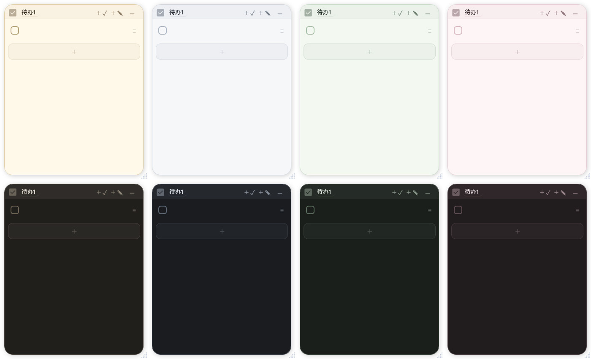
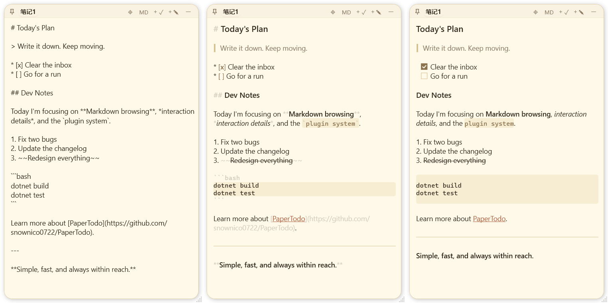
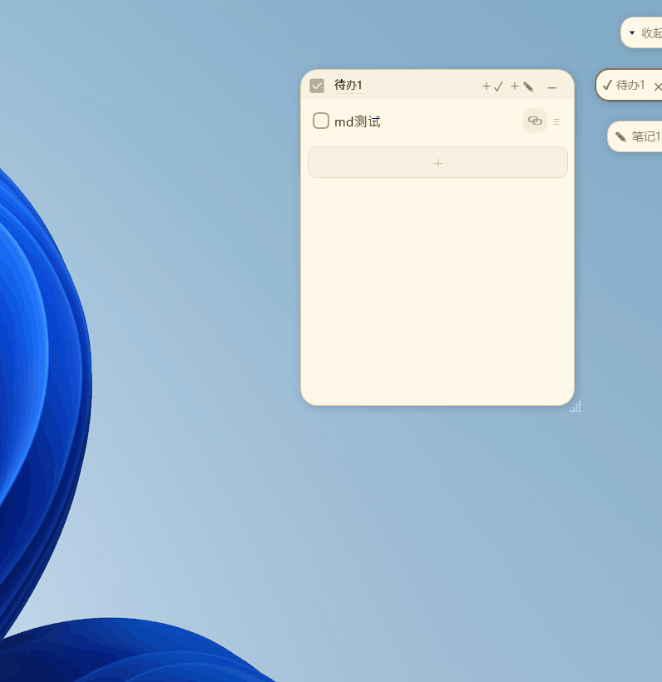
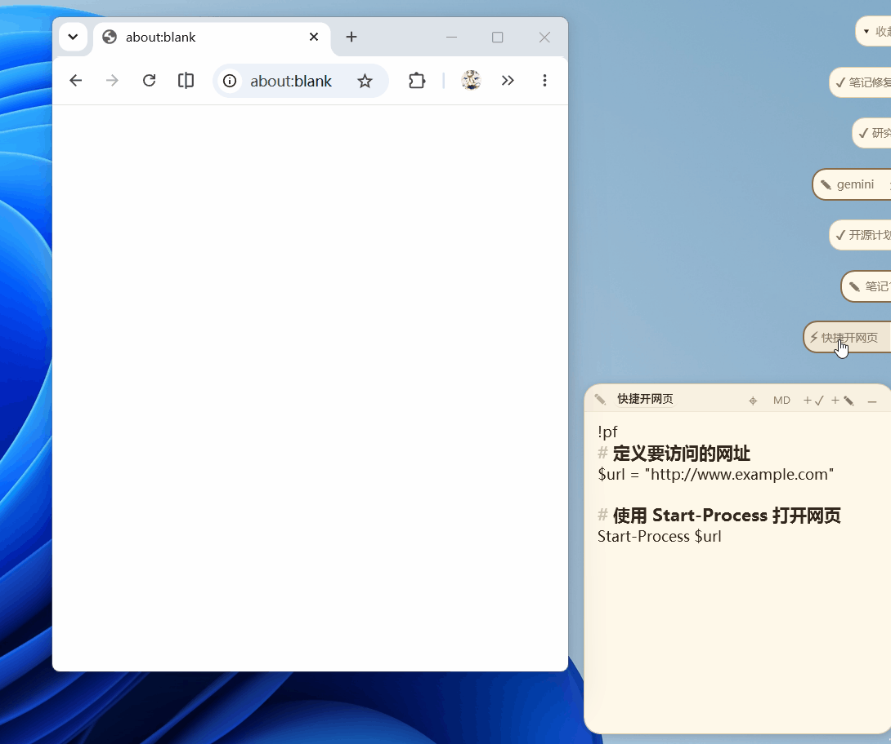
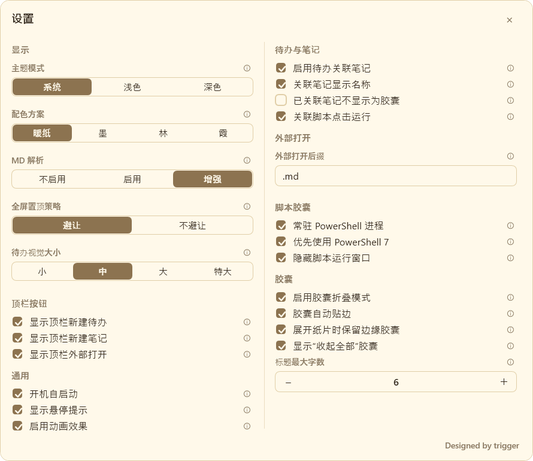

# PaperTodo 用户手册

**语言：简体中文 | [English](USER_GUIDE.en.md)**

> **相关导航**：[项目主页](../README.zh.md) · [插件开发手册](../plugin-samples/README.zh.md) · [版本更新日志](../CHANGELOG.zh.md)
>
> 本手册按当前主线版本维护，已完整覆盖 **v4.0.0-beta2**。如果你使用的是更早发布的安装包，部分新功能请对照对应版本的更新日志；截图仅作示意，具体选项位置请以实际界面为准。

欢迎使用 PaperTodo。如果你是第一次打开软件，可以先花两分钟看完 [1. 快速入门](#1-快速入门)；平时遇到具体问题，直接按目录跳到对应章节查阅即可。

---

## 目录

- [1. 快速入门](#1-快速入门)
  - [1.1 下载与放置位置](#11-下载与放置位置)
  - [1.2 首次启动与桌面形态](#12-首次启动与桌面形态)
  - [1.3 三分钟上手第一张纸](#13-三分钟上手第一张纸)
- [2. 纸片通用操作](#2-纸片通用操作)
  - [2.1 展开态与胶囊态](#21-展开态与胶囊态)
  - [2.2 顶栏与纸片菜单](#22-顶栏与纸片菜单)
  - [2.3 移动、缩放与分屏贴靠](#23-移动缩放与分屏贴靠)
  - [2.4 折叠、隐藏、删除与退出的区别](#24-折叠隐藏删除与退出的区别)
  - [2.5 全文搜索](#25-全文搜索)
  - [2.6 导出待办与笔记](#26-导出待办与笔记)
- [3. 待办纸](#3-待办纸)
  - [3.1 添加、换行与长内容折叠](#31-添加换行与长内容折叠)
  - [3.2 多选、排序与删除](#32-多选排序与删除)
  - [3.3 已完成事项处理](#33-已完成事项处理)
  - [3.4 关联纸片与本地文件](#34-关联纸片与本地文件)
  - [3.5 待办提醒](#35-待办提醒)
- [4. 笔记纸](#4-笔记纸)
  - [4.1 三档渲染与编辑方式](#41-三档渲染与编辑方式)
  - [4.2 支持的 Markdown 语法](#42-支持的-markdown-语法)
  - [4.3 插入与管理本地图片](#43-插入与管理本地图片)
  - [4.4 用外部程序临时打开](#44-用外部程序临时打开)
- [5. 边缘胶囊与悬停预览](#5-边缘胶囊与悬停预览)
  - [5.1 边缘停靠与展开](#51-边缘停靠与展开)
  - [5.2 悬停预览卡片](#52-悬停预览卡片)
  - [5.3 多显示器换边与队列排序](#53-多显示器换边与队列排序)
  - [5.4 自由队列与主胶囊控制](#54-自由队列与主胶囊控制)
- [6. PowerShell 脚本功能](#6-powershell-脚本功能)
  - [6.1 脚本胶囊与指令前缀](#61-脚本胶囊与指令前缀)
  - [6.2 触发运行与常驻会话](#62-触发运行与常驻会话)
  - [6.3 顶栏与菜单的「运行脚本」](#63-顶栏与菜单的运行脚本)
  - [6.4 安全须知](#64-安全须知)
- [7. 快捷键速查](#7-快捷键速查)
  - [7.1 纸片内置快捷键](#71-纸片内置快捷键)
  - [7.2 全局快捷键](#72-全局快捷键)
  - [7.3 侧边胶囊快速启动（1~9）](#73-侧边胶囊快速启动19)
- [8. 设置与进阶能力](#8-设置与进阶能力)
  - [8.1 常规与「笔记与待办」设置](#81-常规与笔记与待办设置)
  - [8.2 视觉与文字：皮肤、材质、背景与字体](#82-视觉与文字皮肤材质背景与字体)
  - [8.3 快捷键设置](#83-快捷键设置)
  - [8.4 多工作区管理](#84-多工作区管理)
  - [8.5 MCP 本地接口、AI 图片导入与外部数据合并](#85-mcp-本地接口ai-图片导入与外部数据合并)
  - [8.6 插件安装、启停与常用示例插件](#86-插件安装启停与常用示例插件)
  - [8.7 实验室功能](#87-实验室功能)
- [9. 托盘菜单与命令行参数](#9-托盘菜单与命令行参数)
  - [9.1 系统托盘菜单](#91-系统托盘菜单)
  - [9.2 命令行启动参数](#92-命令行启动参数)
- [10. 数据备份、迁移与异常恢复](#10-数据备份迁移与异常恢复)
  - [10.1 数据文件与目录结构](#101-数据文件与目录结构)
  - [10.2 日常备份方法与自动历史包](#102-日常备份方法与自动历史包)
  - [10.3 换电脑迁移与故障恢复](#103-换电脑迁移与故障恢复)
- [11. 常见问题解答（FAQ）](#11-常见问题解答faq)

---

## 1. 快速入门

### 1.1 下载与放置位置

前往 GitHub [Releases 页面](https://github.com/snownico0722/PaperTodo/releases) 下载 Windows x64 绿色单文件版：

| 安装包文件名 | 特点 | 适合谁用 |
| :--- | :--- | :--- |
| `PaperTodo-...-self-contained.exe` | 已内置 .NET 运行时 | **推荐绝大多数用户下载**，双击即可运行，不用额外装环境 |
| `PaperTodo-...-no-runtime.exe` | 体积更小，不含运行时 | 电脑里已经装好 **.NET 10 Desktop Runtime (x64)** 的用户 |

> [!IMPORTANT]
> 请先在电脑里新建一个专门的可写文件夹（比如 `D:\Apps\PaperTodo\`），把 `PaperTodo.exe` 放进去再运行。
> **不要**直接在压缩包预览窗口、临时解压目录或没有写入权限的系统目录里双击运行，否则便签文字和图片可能无法正常保存。后续升级新版本时，先从系统托盘退出旧版，再用新 `exe` 覆盖原文件即可，原有数据会自动保留。

### 1.2 首次启动与桌面形态

双击启动后，你会看到两样东西：

- 桌面中央出现一张默认的**待办纸**；
- Windows 任务栏右下角（系统托盘）出现常驻的 **PaperTodo 图标**。

PaperTodo 没有传统的“主管理窗口”——每张纸都是独立的桌面小窗口，系统托盘图标则是管理所有纸片的总入口。如果纸片被其他软件挡住了，或者拔掉外接显示器后跑到了屏幕外，**双击托盘图标**就能把当前工作区的所有纸片重新带回眼前。

每个工作区最多可以保留 **200 张纸片**。需要注意的是，把纸片“折叠”或“隐藏”只是暂时收起，不会释放数量上限；确实不再需要的纸片，右键删除即可。

### 1.3 三分钟上手第一张纸

1. **记下待办**：点击待办纸的空白行输入内容，按 <kbd>Enter</kbd> 继续添加下一条。
2. **勾选完成**：点击事项左侧的方框打勾，文字会自动加上删除线。
3. **移动与置顶**：按住顶栏空白处就能拖动窗口；点击左上角图钉可以让纸片保持在最前。
4. **折叠贴边**：点击右上角收起按钮（或按 <kbd>Ctrl</kbd> + <kbd>W</kbd>）。开启胶囊贴边后，纸片会缩成一颗小胶囊靠在屏幕边缘。
5. **悬停速览**：把鼠标移到边缘胶囊上，不用展开窗口就能直接看内容、打勾完成；单击胶囊则会重新展开完整纸片。

所有修改都会自动保存。想在多张纸片里找东西时，直接按 <kbd>Ctrl</kbd> + <kbd>F</kbd> 就能全局搜索。

---

## 2. 纸片通用操作

<div align="center">
  
</div>

### 2.1 展开态与胶囊态

每张纸片平时都在两种形态之间切换：

- **展开态**：完整的便签窗口，适合集中编辑文字、勾选清单和查看图片。
- **胶囊态**：折叠后的药丸状小浮标，可以整齐停靠在屏幕左右边缘，也可以单独浮在桌面上。

点击右上角按钮、按 <kbd>Ctrl</kbd> + <kbd>W</kbd>，或者用**鼠标中键点击顶栏**，都可以把展开的纸片收成胶囊。如果你在设置里关闭了胶囊模式，这几个操作就会改为把纸片直接隐藏到后台。

### 2.2 顶栏与纸片菜单

纸片顶栏由几枚固定控件和一组可自由排布的快捷操作组成：

| 控件 / 快捷项 | 类别 | 作用与用法 |
| :--- | :--- | :--- |
| **图钉** | 固定控件 | 切换当前纸片是否置顶；开启全屏避让后，遇到全屏游戏或视频会自动退后 |
| **纸片标题** | 固定控件 | 点击即可改名，按 <kbd>Enter</kbd> 或点空白处保存。默认显示上限为 6 个汉字等效宽度（英文、数字等半角字符按 0.5 个折算）；调低显示上限只会隐藏多余字符，不会截断已保存的原名 |
| **`···` 按钮** | 固定控件 | 打开纸片操作菜单（和右键点击纸片外框弹出的是同一套菜单），包含未放上顶栏的快捷项、导出、工作区与设置入口 |
| **折叠 / 隐藏** | 固定控件 | 收起当前纸片；关闭胶囊模式时改为隐藏纸片 |
| **关联拖拽** | 内置快捷 | 按住拖到某条待办上可建立纸片关联；开启实验室“外部窗口绑定”后，也能拖到其他软件窗口上贴靠跟随 |
| **工作区** | 内置快捷 | 开启多工作区后可用；默认点击切换到下一个工作区，也可设为点击展开名称菜单 |
| **新建笔记 / 新建待办** | 内置快捷 | 快速创建一张新的笔记纸或待办纸 |
| **外部编辑** | 内置快捷 | 仅在内置 Markdown 笔记上生效，将笔记临时导出并用系统关联编辑器打开（见 [4.4](#44-用外部程序临时打开)） |
| **运行脚本** | 内置快捷 | 一键执行预先配置好的公共 PowerShell 脚本（见 [6.3](#63-顶栏与菜单的运行脚本)） |

你可以在 **设置 → 常规 → 顶栏快捷操作** 中自由调整这 6 项内置快捷的位置：

- **拖拽分组与排序**：把常用项拖到「显示在顶栏」，不常用的拖到「显示在扩展菜单」，待办纸与笔记纸共用这一套顺序（当前纸片不适用的项目会自动略过）。
- **窄窗口自动收纳**：当纸片宽度不够摆下顶栏快捷按钮时，固定在顶栏的这组按钮会整组临时收进 `···` 菜单，不会在顶栏和菜单里重复出现。即使「关联拖拽」被收进了菜单，依然可以直接从菜单项上按住拖出。
- **彻底隐藏入口**：勾选某一项右侧的「隐藏」后，它会同时从顶栏、`···` 菜单以及右键菜单中隐藏，但不会关闭底层功能本身。

新安装默认把「关联拖拽」和「工作区」放在顶栏，其余放进扩展菜单；插件也可以往顶栏或菜单里注册自己的操作按钮（例如 Codex 插件的 `>_`）。

### 2.3 移动、缩放与分屏贴靠

- **移动位置**：按住顶栏没有按钮的空白处拖动即可。
- **调整大小**：直接拖动纸片的任意四条边或四个角（所有皮肤均支持无把手直接缩放）。
- **Windows 分屏贴靠**：把展开的纸片拖向屏幕边缘，可正常触发系统自带的分屏贴靠布局；贴靠时会自动收起窗口阴影，拖离后再恢复。

### 2.4 折叠、隐藏、删除与退出的区别

刚开始使用时容易混淆这四个动作，它们对数据的影响完全不同：

| 操作 | 窗口去哪了 | 内容还在吗 | 怎么重新打开 |
| :--- | :--- | :--- | :--- |
| **折叠** | 变成屏幕边缘或桌面上的小胶囊 | 完整保留 | 单击对应的胶囊即可展开 |
| **隐藏** | 从桌面和边缘队列中隐身，程序仍在后台 | 完整保留 | 右键托盘菜单点击该纸片，或双击托盘图标全部召回 |
| **删除** | 从当前工作区彻底移除 | **永久删除** | 删除非空纸片前会弹窗确认；不想看到某张纸请用“折叠”或“隐藏” |
| **退出** | 保存所有修改并关闭 PaperTodo 进程 | 完整保存在磁盘 | 下次双击 `PaperTodo.exe` 启动即可恢复 |

### 2.5 全文搜索

在任意待办纸或内置 Markdown 笔记里按 <kbd>Ctrl</kbd> + <kbd>F</kbd>，就会浮出搜索栏：

- **搜索范围**：覆盖**当前工作区**里的所有待办事项和内置 Markdown 笔记，同时显示当前纸片命中数和全局总命中数（如需查找其他工作区的内容，请先切换工作区）。
- **快速跳转**：按 <kbd>Enter</kbd> 跳到下一处，<kbd>Shift</kbd> + <kbd>Enter</kbd> 回到上一处。跳到其他纸片时会自动高亮对应内容；如果那张纸正处于胶囊状态，还会自动帮你展开。
- **不挡视线**：搜索栏本身可以按住拖动位置；找完后按 <kbd>Esc</kbd> 或点关闭即可继续编辑。

### 2.6 导出待办与笔记

需要把内容发给别人、整理成网页或转入其他笔记软件时，打开纸片的 `···` 菜单（或外框右键菜单），选择 **导出**，即可按范围导出为 **Markdown** 或 **HTML**：

| 导出范围 | Markdown 格式结果 | HTML 格式结果 |
| :--- | :--- | :--- |
| **当前** | 单个 `.md` 文件（笔记含图片时会生成同名 `-images` 文件夹，分享时请一起打包） | 单个 `.html` 网页（图片已直接内嵌在文件里，发单文件即可用浏览器查看） |
| **全部笔记** | ZIP 压缩包，内含当前工作区全部内置 Markdown 笔记与图片 | ZIP 压缩包，内含当前工作区全部笔记的独立 HTML 文件 |
| **全部待办** | ZIP 压缩包，内含当前工作区全部待办纸（保留顺序、勾选状态与多行正文） | ZIP 压缩包，内含当前工作区全部待办纸的 HTML 清单 |
| **全部笔记与待办** | ZIP 压缩包，汇总当前工作区所有内置笔记与待办 | ZIP 压缩包，汇总当前工作区所有内置笔记与待办网页 |

第三方插件正文不在导出范围内。批量导出期间你可以继续正常编辑纸片，也可以随时在进度窗口点“取消”；若个别历史图片缺失，完成提示会列出清单并在导出稿中留出文字占位。

> [!TIP]
> 「导出」适合用来阅读、归档或分享文稿，但**不等同于完整的软件备份**（它不包含软件设置、窗口布局、多工作区结构与插件数据）。如果要换电脑或做完整数据备份，请看 [第 10 章](#10-数据备份迁移与异常恢复)。

---

## 3. 待办纸

待办纸专为日常任务清单、随手待办与轻量日程设计，打开就能直接逐条输入。

### 3.1 添加、换行与长内容折叠

- **新建与项内换行**：点空白行输入文字，按 <kbd>Enter</kbd> 在下方新建下一条待办；如果想在**同一条待办里分段换行**，按 <kbd>Shift</kbd> + <kbd>Enter</kbd>。
- **编辑与删空行**：单击修改文字，双击快速全选整条内容；在没有关联、也没打勾的空行里按 <kbd>Backspace</kbd>，即可删掉这一空行。
- **上下键跨条移动**：光标在某条待办的第一行或最后一行时，按 <kbd>↑</kbd> / <kbd>↓</kbd> 会自然切进上一条或下一条待办（长按时会在边界停顿，避免一不小心连跳好几条）。
- **长待办折叠**：当单条待办超过 **4 行**时，右侧拖拽手柄（`≡`）上方会出现一枚小箭头，点击即可把它收起为两行预览，再点一下恢复展开。折叠只影响平时浏览时的显示高度，点进去编辑时仍会显示完整文字；如果全局搜索命中了折叠起来的部分，该条待办和右侧小箭头都会高亮提示。
- **多行文本智能粘贴**：从别处复制多行清单粘贴进来时，会自动去掉开头的 `-`、`1.`、`- [ ]` 等列表符号，并按行拆成多条独立待办；按一次 <kbd>Ctrl</kbd> + <kbd>Z</kbd> 就能把整批粘贴撤回。

### 3.2 多选、排序与删除

- **滑动框选多条**：在待办文字左侧区域按住鼠标左键上下滑动，就能一次连选多条事项。
- **单条与整组拖拽排序**：按住右侧手柄（`≡`）上下拖动可调整顺序；多选后再拖，整组待办会保持原有先后顺序一起移动。拖到列表上下边缘时会自动平滑滚动。
- **拖入垃圾桶删除**：拖动待办移到底部快捷栏的垃圾桶区域会进入删除预选，只有在垃圾桶上松手才会真正删除；中途拖出去即可取消。
- **快捷键批量删除与复制**：多选多条待办后，按 <kbd>Backspace</kbd> 可一键批量删除（支持整组撤销 / 重做）；按 <kbd>Ctrl</kbd> + <kbd>C</kbd> 复制纯文本，按 <kbd>Ctrl</kbd> + <kbd>Shift</kbd> + <kbd>C</kbd> 则会复制成带 `- [ ]` / `- [x]` 状态的 Markdown 任务列表。
- **隐藏底部新建栏**：如果不喜欢底部的快速新建栏，可以在 **设置 → 笔记与待办** 里把它关掉（关掉后拖入垃圾桶删除也会一并停用，仍可通过右键菜单或多选按 <kbd>Backspace</kbd> 删除）。

### 3.3 已完成事项处理

在 **设置 → 笔记与待办** 右栏，可以选择打勾完成后的处理方式：

- **完成后自动清除待办**：勾选瞬间直接从列表移除，适合追求桌面极简的场景（点错了随时按 <kbd>Ctrl</kbd> + <kbd>Z</kbd> 撤回）。
- **已完成待办自动置底**：打勾后自动沉到底部已完成区，取消勾选再回到上方未完成区（开启“自动清除”时此项置灰）。

### 3.4 关联纸片与本地文件

当某条待办需要附上详细背景资料或常用文档时，不用把大段文字硬塞进待办里，直接关联过去会清爽得多（相关开关在 **设置 → 笔记与待办**）：

- **关联另一张纸片**：先把目标纸片展开，按住它顶栏（或 `···` 菜单里）的**关联拖拽**图标，拖到某条待办行上松手即可。之后点击这条待办右侧的纸片小图标，就能一键展开那张纸；如果开启了“再次点击胶囊收回纸片”，再点一次还能直接把它收起（即使那张纸没有放进侧边胶囊队列也同样管用）。
- **关联电脑里的文件或文件夹**：直接从 Windows 资源管理器把文件或文件夹拖到待办行上松手。之后点右侧图标就能用系统默认软件打开它，右键还可以“打开所在位置”或取消关联。

### 3.5 待办提醒

先在 **设置 → 笔记与待办** 的「待办提醒」区域打开提醒总开关，之后每条待办右侧（或右键菜单里）就能设置闹钟提醒：

- **预设与自定义时间**：既可以选几分钟后、几小时后、今天傍晚、明天早上等快捷预设，也可以手动指定具体日期和时间。
- **到期通知与提示音**：到点后会自动高亮定位到对应待办，并弹出系统托盘通知。需要声音提示时，可在设置里开启提示音并挑选音效；如果你在 `PaperTodo.exe` 同目录下放了有效的 `papertodo.wav`，则会优先播放这段自定义音频。

提醒依赖 PaperTodo 在后台保持运行，且**只对当前所处的工作区生效**（切到后台的非活动工作区不会触发提醒）。如果安装了接管提醒展示的插件（例如桌宠类插件），到期提示可能会改由插件来呈现。

---

## 4. 笔记纸

<div align="center">
  
</div>

笔记纸用来记录灵感、会议要点、代码片段和图文备忘，兼顾纯文本的轻快和 Markdown 的清晰排版。

### 4.1 三档渲染与编辑方式

你可以在 **设置 → 笔记与待办 → Markdown** 中按习惯切换三档渲染模式：

| 渲染档位 | 呈现与编辑体验 |
| :--- | :--- |
| **关闭** | 完全按纯文本编辑器使用，原样显示所有字符 |
| **基础** | 保留 Markdown 语法符号并提供字号与颜色区分；失焦浏览时淡化标记，显示列表圆点与分割线 |
| **完全渲染** | 标题、列表、引用、代码块、图片和行内格式直接排版成型，**即使正在打字编辑也保持排版效果** |

日常使用中的几个顺手细节：

- **即点即改，局部显码**：在**完全渲染**模式下点击正文编辑时，整篇笔记不会突然退回满屏源码，只有光标停靠的那一处标记会展开源码方便你修改，光标移开就恢复排版。
- **直接点击任务方框**：在完全渲染下写 `- [ ] 待办事项`，无论浏览还是编辑状态，都可以直接用鼠标点击方框打勾或取消勾选（如果光标刚好停在 `[ ]` 字符上，先把光标移开再点即可）。
- **打开超链接**：失焦浏览时单击链接直接打开；正在编辑文字时，按住 <kbd>Ctrl</kbd> 再单击链接。
- **缩放与纯文本复制**：按住 <kbd>Ctrl</kbd> 滚轮可随时放大缩小字号，点右下角百分比一键回到 `100%`；选中内容按 <kbd>Ctrl</kbd> + <kbd>Shift</kbd> + <kbd>C</kbd> 可跳过样式仅复制纯文本。

> [!NOTE]
> 为保证桌面窗口在长文本下的流畅度，单张笔记设有字数保护上限。写满收到提示时，建议按主题拆分成两张笔记并用待办关联串起来。

### 4.2 支持的 Markdown 语法

| 语法类型 | 写法示例 | 渲染效果 |
| :--- | :--- | :--- |
| **分级标题** | `# 一级` / `## 二级` / `### 三级` | 醒目分级标题 |
| **粗体 / 斜体 / 粗斜体** | `**粗体**`、`*斜体*`、`***粗斜体***` | **粗体**、*斜体*、***粗斜体*** |
| **删除线** | `~~作废内容~~` | ~~作废内容~~ |
| **无序 / 有序列表** | `- 项目` 或 `1. 第一步` | 圆点列表 / 自动编号列表 |
| **任务列表** | `- [ ] 未完成` / `- [x] 已完成` | 完全渲染档位下可直接点击勾选 |
| **引用块** | `> 引用内容` | 带左侧竖线的引用段落 |
| **行内代码 / 代码块** | `` `code` `` 或三反引号围栏代码块 | 等宽字体与代码块底色 |
| **超链接与裸网址** | `[说明](https://example.com)` 或直接写 `https://...` | 可点击跳转的链接 |
| **水平分割线** | `---` 或 `***` | 视觉分隔横线 |
| **反斜杠转义** | `\*保留星号原样显示\*` | 不触发格式解析，原样显示符号 |

> [!NOTE]
> PaperTodo 有意保持轻量，内置笔记不支持复杂表格、外链网络图床、附件嵌入或块级 HTML。遇到复杂表格时，可以用顶栏或菜单里的**外部编辑**交给专业 Markdown 软件查看。

### 4.3 插入与管理本地图片

往笔记里放图片有三种方式：

- 截图或复制图片（含透明背景 PNG）后，在笔记中直接按 <kbd>Ctrl</kbd> + <kbd>V</kbd> 粘贴；
- 从文件资源管理器选中一张或多张本地图片，直接拖进笔记窗口；
- 在笔记正文空白处右键，选择 **插入图片**。

插入后正文里会出现类似 `` 的简短引用，真实图片数据会保存在当前工作区对应的本地图片库中（主工作区为 `note-assets.lmdb`，副工作区 2～5 为 `note-assets2.lmdb`～`note-assets5.lmdb`）。右键点击已经渲染出来的图片，可以复制原图或删掉这处引用。

如果你希望让本地 AI 工具（如 Codex、Claude Code）通过命令行自动往笔记里贴图，或通过 MCP 读取笔记图片，请查看 [8.5 MCP 本地接口、AI 图片导入与外部数据合并](#85-mcp-本地接口ai-图片导入与外部数据合并)。

### 4.4 用外部程序临时打开

点击笔记纸顶栏或 `···` 菜单里的 **外部编辑**，PaperTodo 会把这篇笔记连同引用图片一起导出到系统临时目录，并调用 Windows 默认关联的软件打开（如果当前后缀没有关联任何软件，会自动回退用系统记事本打开）。你可以在 **设置 → 笔记与待办** 中修改临时导出文件的后缀名。

> [!NOTE]
> **外部编辑是单向临时预览**：你在外部软件里修改保存后，内容**不会**自动同步回 PaperTodo，需要保留的话请手动复制回纸片。如果要正式保存文件，请用 [2.6 导出待办与笔记](#26-导出待办与笔记)。

---

## 5. 边缘胶囊与悬停预览

<div align="center">
  
</div>

### 5.1 边缘停靠与展开

在 **设置 → 常规** 开启 **胶囊模式** 和 **胶囊贴边模式** 后，折叠起来的纸片就会整齐排列在屏幕左侧或右侧边缘。平时只露出一小截胶囊，单击一下就能在原位置展开成完整纸片。

几个常用的细节选项：

- **再次点击收回纸片**：同时保留“展开时保留边缘胶囊”并开启“再次点击胶囊收回纸片”后，点一下激活态胶囊就能把纸片收回去；如果那张展开的纸已经被别的窗口盖住了，点一下则会先把它重新带回最前，不会误收起。
- **胶囊标题长度与滑动展开**：开启左下角**高级模式**后，可以自定义边缘胶囊显示的字数上限（设为 `0` 可只留图标不显示字）。如果关闭了悬停预览卡片，鼠标移到截短的胶囊上时，标题会自动横向滑出完整文字。
- **隐藏胶囊关闭叉号**：怕鼠标移上去误点关闭的话，可以在高级模式里勾选“悬停时隐藏关闭按钮”，需要隐藏纸片时右键胶囊选“隐藏”即可。

### 5.2 悬停预览卡片

开启 **启用悬停预览** 后，把鼠标停在边缘胶囊上就能直接弹出轻量预览卡片（最大高度统一限制在 320 DIP，短内容自适应），不用频繁开关大窗口：

- **待办卡片直接操作**：可以在卡片里直接上下滚动、勾选或取消完成待办，也能直接点击关联纸片或关联文件图标；点卡片空白处则展开完整纸片。
- **笔记卡片即时排版**：跟随笔记当前的 Markdown 渲染档位展示前 **6000 个字符**（超长笔记展开完整窗口即可查看全文，预览不会截断原内容）。
- **顺滑连读与防误触**：沿着一列胶囊上下移动鼠标时，预览卡片会平滑接力切换；刚拖完胶囊松手时，预览会等鼠标稍微停稳再弹出，移向别处不会误触发刚挪动的胶囊。
- **优先向下展开**：默认在切换相邻胶囊时会复用上方已腾出的空间；如果你更习惯卡片始终贴着鼠标往下展开，可在常规设置中开启“浏览时优先向下展开”。

### 5.3 多显示器换边与队列排序

- **上下调整顺序**：在同一侧边缘队列里，按住胶囊上下拖动即可重排顺序，相邻胶囊会自动平滑让开并显示落点虚影。
- **跨边与跨显示器转移**：按住胶囊往横向拉出边缘，直接拖到当前屏幕另一侧，或者拖到另一台显示器的左右边缘松手即可。
- **记住跨屏展开位置**：开启“记住展开位置”后，哪怕胶囊停在副屏，展开后的大窗口也能记住你在主屏（或任意显示器、不同缩放比例下）摆好的位置和尺寸。

### 5.4 自由队列与主胶囊控制

默认情况下，屏幕每一侧边缘的所有胶囊排成一整列；如果你希望把不同用途的胶囊分堆摆放，可以在 **设置 → 常规** 中开启 **胶囊自由队列**：

- **拖出独立成组**：开启自由队列后，把任意一颗胶囊拖离原来的队伍，在屏幕边缘的空白处松手，就能单独建起一组新队列。
- **整组搬移**：按住 <kbd>Ctrl</kbd> 拖动组内任意胶囊，或者直接拖动该组顶部的**主胶囊**，就能把这一整组一起上下挪动（关闭自由队列时，按住 <kbd>Ctrl</kbd> 拖动只移动单颗胶囊）。
- **主胶囊的四个顺手操作**：
  1. **单击收放整队**：左键点一下主胶囊，整组胶囊会平滑收进主胶囊下方，再点一下重新展开。
  2. **上下调高度**：上下拖动主胶囊，调节这组队列在屏幕边缘的起始高度。
  3. **横向整队跨屏**：横向拉出主胶囊，拖到屏幕另一侧或其他显示器边缘松手，整列胶囊就会按原顺序一起搬过去。
  4. **右键打开全局菜单**：右键主胶囊会直接弹出与系统托盘一致的管理菜单。
- **精简样式**：开启高级模式后，可在常规设置中勾选 **主胶囊缩短**，让主胶囊只保留小箭头、隐藏数字计数。

---

## 6. PowerShell 脚本功能

<div align="center">
  
</div>

如果你平时常跑一些清理缓存、切环境、查服务或自动化小命令，PaperTodo 提供了两种轻量运行方式。

### 6.1 脚本胶囊与指令前缀

新建一张普通笔记纸，在**第一行**单独写上指令前缀，从**第二行**开始写 PowerShell 代码：

```powershell
!p
Get-Service | Where-Object Status -eq 'Running' | Select-Object -First 5
```

| 首行前缀（半角感叹号） | 执行方式说明 |
| :--- | :--- |
| `!p` 或 `!power` | 自动选择可用的 PowerShell 版本运行，出错时弹窗提示 |
| `!pwsh` 或 `!ps7` | 指定使用电脑上已安装的 PowerShell 7 |
| `!ps5` 或 `!winps` | 指定使用系统自带的 Windows PowerShell 5.1 |
| `!pf` 或 `!powerf` | 配合常驻进程模式复用同一个后台会话，保留上一次运行后的变量与环境 |

### 6.2 触发运行与常驻会话

- 把写有脚本前缀的笔记**折叠成胶囊**后，它会带上醒目的**闪电图标（`⚡`）**。此时左键单击胶囊会**直接运行脚本**，而不会展开笔记。
- 想回去改脚本代码时，**右键点击脚本胶囊**，选择 **展开为纸片** 即可。
- 开启左下角高级模式后，可以在 **设置 → 笔记与待办 → 脚本胶囊** 中配置是否启用常驻进程、优先调用 PowerShell 7，以及运行时是否隐藏控制台窗口（修改这几项设置只对下一次新启动的脚本生效，不会打断正在运行的脚本）。

### 6.3 顶栏与菜单的「运行脚本」

除了专门建一张脚本胶囊，你还可以在 **设置 → 常规 → 顶栏快捷操作** 中找到 **运行脚本**，点右侧的 **编辑脚本** 保存一段随时调用的公共脚本：

- 既可以把它拖到顶栏做成一键按钮，也可以留在 `···` 菜单里按需点击（还没配过脚本时直接点击运行，会自动先弹出编辑框）。
- 这里支持直接写普通 PowerShell 命令（不写首行前缀时默认按 `!p` 规则执行），也同样支持在第一行写 `!pwsh`、`!pf` 等前缀。运行引擎、窗口显隐和工作区设置继承规则均与脚本胶囊保持一致。

### 6.4 安全须知

> [!CAUTION]
> 所有脚本都会以当前登录用户的系统权限直接执行，**没有任何沙箱隔离**。请只运行你自己编写或完全确认安全的命令，切勿随意粘贴运行来历不明的脚本。

---

## 7. 快捷键速查

### 7.1 纸片内置快捷键

| 快捷键 | 适用位置 | 作用说明 |
| :--- | :--- | :--- |
| <kbd>Ctrl</kbd> + <kbd>F</kbd> | 待办 / 笔记 | 搜索当前工作区的全部待办与内置 Markdown 笔记 |
| <kbd>Enter</kbd> / <kbd>Shift</kbd> + <kbd>Enter</kbd> | 待办编辑 | 新建下一条待办 / 在当前待办内换行 |
| <kbd>Enter</kbd> / <kbd>Shift</kbd> + <kbd>Enter</kbd> | 搜索栏 | 跳转到下一处 / 上一处匹配结果 |
| <kbd>Ctrl</kbd> + <kbd>W</kbd> | 展开纸片 | 折叠当前纸片（关闭胶囊模式时改为隐藏） |
| <kbd>Esc</kbd> | 纸片通用 | 依次用于关闭搜索栏、取消拖拽或取消待办多选；无上述状态时收起纸片（正在改标题会先保存再收起；不可折叠时则取消改名或图片选中） |
| <kbd>Ctrl</kbd> + <kbd>Z</kbd> / <kbd>Ctrl</kbd> + <kbd>Y</kbd> | 待办 / 笔记 | 撤销 / 重做（包含多行粘贴与多选批量删除） |
| <kbd>Backspace</kbd> | 待办多选 | 批量删除选中的多条待办（输入框内有文字选区时仍只删文字） |
| <kbd>Ctrl</kbd> + <kbd>Shift</kbd> + <kbd>C</kbd> | 待办多选 / 笔记 | 待办复制为 `- [ ]` / `- [x]` 任务清单；笔记复制为不带格式的纯文本 |
| <kbd>↑</kbd> / <kbd>↓</kbd> | 待办编辑 | 在首行或末行边界切换到上一条 / 下一条待办 |
| <kbd>Ctrl</kbd> + <kbd>B</kbd> / <kbd>I</kbd> / <kbd>K</kbd> | 笔记编辑 | 加粗 / 斜体 / 插入超链接 |
| <kbd>Ctrl</kbd> + 滚轮 | 笔记浏览与编辑 | 放大或缩小笔记字号（点右下角百分比复位 `100%`） |

第三方插件也可以注册专属快捷键，或在插件处于交互态时接管其内部的 <kbd>Esc</kbd> 键，具体以对应插件说明为准。

### 7.2 全局快捷键

在 **设置 → 快捷键** 中录入组合键后，哪怕正在使用别的软件，也能随时呼出或控制纸片：

- **常用全局动作**：显示全部、隐藏全部、切换显隐、新建待办、新建笔记、退出程序；
- **实验室全局动作**（开启高级模式后在「实验室」页配置）：锁定/解锁全部便签、一键切换全部纸片/当前焦点纸片/全部胶囊半透明、将当前纸片或全部纸片与胶囊置底并开启鼠标穿透。

录入时请使用 <kbd>Ctrl</kbd>、<kbd>Alt</kbd>、<kbd>Shift</kbd>、<kbd>Win</kbd> 搭配普通按键；如果状态栏提示“应用内重复”或“系统占用”，换一组按键即可。

### 7.3 侧边胶囊快速启动（1~9）

开启 **快速启动侧边胶囊** 后，可以用快捷键直接展开屏幕侧边队列里的第 `1`～`9` 颗胶囊（主胶囊不计入序号）：

- **左侧队列**默认为 <kbd>Ctrl</kbd> + <kbd>Shift</kbd> + <kbd>1~9</kbd>；
- **右侧队列**默认为 <kbd>Ctrl</kbd> + <kbd>Alt</kbd> + <kbd>1~9</kbd>。

你可以只修改前面的修饰键组合，数字固定为 `1`～`9`。“区分小键盘数字键”开关只针对普通全局快捷键生效，不影响这组侧边快速启动序列。

---

## 8. 设置与进阶能力

右键系统托盘图标选择 **设置**。左侧导航栏上方是日常高频使用的 **常规**、**笔记与待办**、**视觉与文字**、**快捷键**；分隔线下方是进阶管理相关的 **工作区与数据** 与 **插件**。勾选左下角的 **高级模式** 后，各页面会展开更多细调开关，并额外显示 **实验室** 页面（再次关闭高级模式只会收起界面入口，不会改掉你已经配好的选项）。每个选项旁的 `ⓘ` 悬停即可查看简短说明。

<div align="center">
  
</div>

### 8.1 常规与「笔记与待办」设置

- **常规**：设置界面语言（切换后重启生效）、开机自启动、顶栏快捷操作排布、胶囊模式、自由队列与边缘悬停预览。开启高级模式后，还可配置在任务栏与 `Alt+Tab` 中隐藏窗口、全屏程序自动避让、纸片与胶囊标题显示字数上限，以及主胶囊缩短样式。
- **笔记与待办**：同一页面左右分栏排布，两栏底部均可独立“恢复默认”：
  - **左栏（笔记）**：Markdown 三档渲染、完全渲染编辑过渡动画、外部打开文件后缀；高级模式下可开启大图自动压缩与脚本胶囊运行参数。
  - **右栏（待办）**：底部快捷新建栏开关、已完成项自动清除 / 置底、关联纸片与关联文件显示方式，以及待办提醒与提示音设置。

### 8.2 视觉与文字：皮肤、材质、背景与字体

所有外观相关的定制都集中在 **视觉与文字** 页：

- **提示与动画节奏**：可独立开关普通按钮悬停提示（不影响设置页里的 `ⓘ` 帮助说明）、界面过渡动画，以及 **快速动画**（开启后将展开、折叠等视觉动画时长缩短至原来的 60%，待办提醒计时不受影响）。
- **主题与五套配色**：支持跟随系统、浅色、深色；内置**暖纸、墨、林、霞、素灰**五套配色。
- **七种实验皮肤与原生材质**：提供**默认纸片、标准云母、标准亚克力、透色亚克力、半透明描图纸、Aero 玻璃、像素风**七种皮肤，且每种皮肤都可以独立记忆各自选定的配色：
  - 云母、亚克力、描图纸与 Aero 的系统级原生材质需要 **Windows 11 22H2 及以上系统**（首次开启按提示重启软件即可生效；24H2 及以上支持材质一体延伸至标题栏；系统不支持或关闭透明效果时会自动平滑回退为实色）。
  - **五档材质透明度**：提供从“最低”到“最高”五档调节，只改变展开纸片和设置窗口的背景质感，**正文文字始终保持清晰不发虚**；边缘胶囊与右键菜单则固定采用干净易读的轻量底色。
- **字体与字重**：内置语言默认、微软雅黑、等线预设，支持全局缩放、分区域独立调字号与加粗，以及标准 / 柔和 / 锐利三种文字渲染策略。

#### 自定义纸片背景图

1. 准备一张 `.png`、`.jpg` 或 `.jpeg` 图片，重命名为 `papertodo.png`（或 `.jpg` / `.jpeg`，多张并存时按 `PNG > JPG > JPEG` 优先），直接放到 **`PaperTodo.exe` 所在目录**（不要放进 `assets/` 或 `plugins/`）。
2. 重启软件后，打开 **设置 → 视觉与文字**，底部就会出现 **纸片背景** 设置区。
3. 按喜好调整三个选项：
   - **启用和配色混合**：开启时会在图片上柔和叠一层当前纸片配色；关闭则直接显示原图色彩（注意：这不是背景总开关，要彻底去掉背景图，把目录里的图片移走或改名后重启即可）。
   - **拉伸**：开启后保持宽高比铺满整张纸；关闭时大图等比缩小容纳，小图保持原始尺寸。
   - **位置**：未开启拉伸时，可选择居中、左下、正下或右下对齐。

背景最长边按最高 4096 像素解码（不会修改你的原图文件），混合与对齐偏好保存在 `%LOCALAPPDATA%\PaperTodo\paper-background.json`。

#### 导入自定义字体

1. 把字体文件改名为 `papertodo.ttf` 或 `papertodo.otf`，直接放在 `PaperTodo.exe` 同目录。
2. 如果这套字体有专门的粗体字重文件，可以一并命名为 `papertodo_bold.ttf`（或 `.otf`）放在旁边，并在 **视觉与文字** 页开启 **自定义字体增强加粗**。
3. 从托盘退出并重新启动软件即可生效。

### 8.3 快捷键设置

点击对应命令右侧的录制框，按下想要的组合键即可完成绑定；点击页面底部的 **恢复默认** 会把快捷键与“区分小键盘数字键”一并重置。各插件自带的快捷键请在对应插件的设置卡片中修改。

### 8.4 多工作区管理

如果你希望把“上班的工作待办”和“下班后的个人记录”彻底分开，不想让它们挤在同一排边缘胶囊里，可以在 **设置 → 工作区与数据** 中开启 **启用工作区**：

- **最多 5 个独立空间**：默认使用的是 **主工作区（1）**，最多可以新建到 **5 个工作区**（副工作区固定使用编号 `2`～`5`）。每个工作区都有自己独立的纸片、桌面布局、图片库和插件私有数据。
- **多处一键切换与移动纸片**：
  - **在设置页管理**：点选工作区卡片后点**确认切换**；点名称旁的铅笔图标（`✎`）可以随时改名（改名不会变动底层文件编号），点对号（`✓`）保存。
  - **从顶栏、右键或托盘切换**：顶栏的「工作区」快捷按钮默认点一下切到下一个工作区；勾选 **按名称切换** 后，点击就会展开完整的工作区菜单。这套菜单和纸片 `···` 菜单、胶囊右键里的「工作区」子菜单完全一致，都能直接**切换工作区、把当前纸片「移动到」其他工作区**（正文、关联图片和该纸片的插件数据会一起搬过去），或者**创建新工作区**。
- **副工作区的「跟随主设置」**：新建的副工作区默认勾选 **跟随主设置**。开启跟随期间，副工作区会自动沿用主工作区的软件外观、快捷键、MCP 权限以及**插件的启用/禁用状态**（此时切到副工作区看其他设置页会显示为只读；想改全局设置，切回主工作区改，或者先关掉该副工作区的“跟随主设置”即可）。而纸片内容、图片以及插件自身的配置和业务数据，始终归各个工作区自己独立保存。
- **活动边界清晰**：全文搜索、显示/隐藏全部、批量导出以及日常 MCP 读写，都只针对**当前正在使用的工作区**；切到后台的工作区不会保留隐藏窗口、后台插件实例或待办提醒。关闭工作区总开关只会停用多工作区入口，不会删掉任何文件；只有在副工作区卡片上点 **删除** 并二次确认，才会永久清除该工作区的数据。

### 8.5 MCP 本地接口、AI 图片导入与外部数据合并

在 **设置 → 工作区与数据** 下方，提供了面向本地 AI 客户端与自动化工具的协作能力：

#### 1. 开启与连接本地 MCP

1. 在 **MCP 本地接口** 区域打开 **启用 MCP 连接**。
2. 按实际需要勾选权限：**允许新增和追加内容**、**允许修改已有内容**、**允许删除内容**（未勾选任何写权限时，外部 AI 只能只读查看纸片与设置）。
3. 点击 **复制 JSON 配置**（或 **复制 Codex 配置**），粘贴到 Claude Desktop、Cursor、Codex 等支持标准 stdio MCP 的本地客户端中（连接命令为 `PaperTodo.exe --mcp`）。

启用后，AI 客户端即可在授权范围内读写**当前活动工作区**的纸片、待办（含 `order` 排序、提醒与纸片关联）、内置 Markdown 笔记（含正在编辑尚未落盘的最新文字）以及公共软件设置。请只向你信任的本地工具授予写或删权限。

#### 2. 本地 AI 图片导入与读取

为了避免让大模型在上下文里直接搬运庞大的 Base64 字符串，笔记图片的“读”和“写”采用分工设计：

- **AI 读取笔记图片（走 MCP）**：先调用 `get_paper` 查看正文里的 `i:图片ID` 引用，再调用 `read_note_image(paper_id, image_id)`，支持视觉能力的客户端就能直接看到原图（无需开启写入权限，但只能读取当前笔记正文里仍在引用的图片）。
- **AI 追加图片到笔记末尾（走本地命令行二进制流）**：当主程序正在运行、且已开启 MCP 与“允许新增和追加内容”权限时，具备本地命令执行能力的 AI 助手（如 Codex、Claude Code）可调用 `--import-note-image`，把原始图片字节（上限 **4 MiB**）通过标准输入流传给 PaperTodo，自动追加到目标内置笔记末尾并返回简短 JSON 结果：

```python
from pathlib import Path
import subprocess

image_bytes = Path(r"C:\Pictures\screenshot.png").read_bytes()
result = subprocess.run(
    [r"C:\Apps\PaperTodo\PaperTodo.exe", "--import-note-image",
     "--paper-id", "替换为目标笔记ID", "--image-name", "screenshot.png"],
    input=image_bytes,
    capture_output=True,
    check=False,
)
print(result.stdout.decode("utf-8"))  # 返回图片 ID 与 Markdown 引用
if result.returncode != 0:
    raise RuntimeError(result.stderr.decode("utf-8", errors="replace"))
```

> **调用注意**：在 PowerShell 中调用时请通过 `Process.StandardInput.BaseStream` 写入原始字节，不要用文本管道。该命令不接收文件路径、网址或 Base64 文本；退出码 `0` 为成功，`1` 为导入被拒或失败（例如目标笔记末尾有未闭合代码块，或中途正在切换工作区），`2` 为参数错误。

#### 3. 外部修改数据后的重新载入与三方合并

PaperTodo **不会在后台轮询监控磁盘文件**——软件运行期间如果你直接用外部工具改了 `data.json`，软件不会自动感知，下一次自动保存还可能把外部改动覆盖掉。

如果插件或外部 MCP 工具确实需要按文件级导入修改，请使用专门提供的两个接口（均需完整写入权限，且仅作用于当前活动工作区）：

- **`reload_data`（直接重载）**：直接读取磁盘上的当前工作区数据文件替换内存状态，未保存的界面修改会被覆盖。
- **`merge_data`（三方合并）**：外部工具在修改前先保留一份完整的原始 JSON，写完磁盘后把这份原始 JSON 作为 `baseline_json` 传给 `merge_data`。PaperTodo 会对比“原始基线、软件内修改、外部修改”三方差异：互不冲突的改动自动合并，真正撞车的字段则按 **设置 → 工作区与数据 → 数据处理 → 合并数据时遇到冲突** 中选定的策略（默认**冲突时询问**，也可设为**导入数据优先**或**当前数据优先**）处理，并自动保留最近 5 组冲突归档备查。

### 8.6 插件安装、启停与常用示例插件

插件可以把一张笔记纸变成桌面时钟、专注番茄钟、复盘面板，也可以给所有纸片加上顶栏按钮、待办行内动作、右键菜单或后台事件转发。当前版本支持 **插件协议 2.1～2.3**（旧版 2.1 / 2.2 插件无需修改即可继续使用）。

> [!WARNING]
> PaperTodo 不对插件做沙箱隔离，Web 插件（基于 WebView2）与 Native 原生插件（基于 .NET 10 + WPF）都拥有与当前用户一致的系统权限。请仅安装来源可信的插件；如需自行开发插件，请参阅 [插件开发手册](../plugin-samples/README.zh.md)。

#### 安装插件的步骤

1. **准备成品文件夹**：注意区分“插件成品”和“插件源码”——仓库 [`plugins/`](../plugins/) 目录下放的是可直接使用的成品，而 [`plugin-samples/`](../plugin-samples/) 里放的是开发源码（Native 源码目录未编译时不能直接塞进 `plugins/` 使用）。主程序安装包默认不捆绑插件，按需复制即可。
2. **放入 `plugins/` 目录**：将插件成品放到 `PaperTodo.exe` 同级的 `plugins/<插件 ID>/` 下，确保文件夹名字与里面的 `plugin.json` 的 `id` 完全一致，且打开这层文件夹就能直接看到 `plugin.json`（不要多套一层外层目录）。
3. **重启扫描并启用**：如果软件正在运行，打开 **设置 → 插件**，点击右上角的 **重启 PaperTodo 并重新扫描插件**（或从托盘退出再重开）。识别成功后，在卡片上确认开关已打开；提供独立界面的插件，右键任意笔记纸在 **正文类型** 中即可切换过去。

#### 插件启停与运行状态

在 **设置 → 插件** 中拨动插件名称旁的开关即可随时启用或停用，鼠标停在开关上可查看当前状态：

- **插件已禁用**：立即停止该插件的界面与后台服务，原纸片显示停用提示，但所有已保存的纸片与插件数据都会完好保留；重新打开开关即可恢复。
- **插件已启用，当前未运行**：插件允许运行，只是当前工作区里还没有创建该插件的纸片或后台实例，属于正常待命状态。
- **插件运行中**：该插件的纸片正文或后台服务正在工作（若加载异常会单独提示问题原因）。

宿主管理的插件配置与状态按工作区分别存放在 `plugins/data/`（主工作区）和 `plugins/data2/`～`plugins/data5/`（副工作区）。

#### 常用官方示例插件说明

仓库 `plugins/` 目录已内置多款可直接复制使用的插件，包括原生时钟、官方 Web 时钟、专注番茄钟、待办复盘记录池，以及下面两款联动工具：

- **Webhook 事件转发（`sample.webhook.native`）**：在插件设置的「事件路由」里填入事件名到 HTTP(S) 地址的 JSON 映射，就能在纸片、待办、笔记发生变化或提醒即将到期前 5 秒时，自动发送 JSON POST 通知，修改路由后立即生效（详见 [Webhook 示例插件说明](../plugin-samples/PaperTodo.Plugin.Webhook/README.md)）。
- **Codex CLI Bridge（`tools.codex-cli-bridge.native`）**：搭配本机已安装并登录的 Codex CLI 使用（沿用你本机自己的 Codex 账号、审批与沙箱配置，并非内置在线 AI 服务）：
  - **两处发送入口**：点击单条待办右侧的 `>_` 发送该条待办（自动附带关联纸片文字、关联文件路径或本地图片）；点击纸片顶栏的 `>_` 发送整张待办纸或笔记全文。默认都会打开前台 PowerShell 窗口执行并在跑完后保留窗口，勾选插件设置里的“后台执行”后才会静默运行。
  - **默认模型与多语言提示词**：默认使用 `gpt-6-astra`（推理档位 `xhigh`；把字段清空即可沿用你本机 CLI 的默认配置）。插件界面与未改过的内置默认提示词会跟随软件语言切换，你自己改过的提示词不会被覆盖；用于编辑默认提示词的 `Codex CLI` 纸片在启动时默认隐藏，点 **更多设置 → 编辑提示词** 就能随时呼出。
  - **三个独立开关（默认均开启）**：「开启插件技能」与「开启本软件操作技能」控制发送任务时是否附带对应开发/操作指南；「允许本插件开启 MCP」则允许 Codex 在任务确实需要操作便签时自动开启本地 MCP 及读写删除权限（注：关闭此开关只会阻止今后自动开启，若此前已开启过 MCP 权限，请到“工作区与数据 → MCP 本地接口”中手动关闭）。详见 [Codex CLI Bridge 示例插件说明](../plugin-samples/PaperTodo.Plugin.CodexCliBridge/README.md)。

### 8.7 实验室功能

勾选左下角 **高级模式** 后，可在左侧导航底部的 **实验室** 页体验更多深度桌面交互：

- **外部窗口绑定**：按住纸片顶栏（或菜单中）的**关联拖拽**图标，拖到任意第三方软件窗口上松手，纸片就会贴靠在该窗口边缘，跟着它一起移动、最小化和恢复（目标窗口最小化或隐藏时纸片也会暂时隐藏；如果此时你手动把纸片重新显示出来，会自动解除绑定）。双击顶栏已绑定的关联图标可随时解绑；右键该图标选 **打开目标程序** 还能直接唤醒或重新启动那个软件，对方重启后也会自动恢复跟随。
- **边缘磁吸胶囊**：当你关闭了固定排队的“胶囊贴边模式”、使用普通自由浮动胶囊时，开启此项可让胶囊靠近屏幕边缘或外部窗口边缘时产生磁吸效果，悬停滑出、移开收回。
- **失焦与静置淡化**：支持让纸片在失去焦点后自动收起成胶囊、隐藏顶栏操作按钮或整个标题栏、自动降低不透明度，以及让平时静置的胶囊自动半透明（悬停或拖动时立刻恢复清晰）。
- **置底穿透与交互锁定**：配合实验室全局快捷键，可以把纸片和胶囊钉在桌面最底层并开启鼠标点击穿透（像壁纸挂件一样完全不挡鼠标操作；需要恢复时按快捷键或右键托盘点 **恢复纸片与胶囊交互**），也可以一键锁定全部便签防止误改。

---

## 9. 托盘菜单与命令行参数

### 9.1 系统托盘菜单

右键点击任务栏右下角的 PaperTodo 图标，即可打开全局控制菜单：

- **顶部栏**：显示当前版本号，点右侧齿轮打开 **设置**。
- **工作区栏**（开启多工作区后显示）：点左侧「工作区」直达设置页，点右侧数字编号或 `+` 号快速切换或新建工作区。
- **纸片快捷栏**：点左侧眼睛图标一键显示 / 隐藏当前工作区的全部纸片；点右侧两个加号图标快速新建待办纸或笔记纸。
- **当前工作区纸片列表**：点击任意纸片标题可切换显示与隐藏；点右侧 `×` 再点 **确认** 会永久删除该纸片。
- **恢复交互与退出**：如果有纸片正处于置底鼠标穿透状态，菜单里会出现 **恢复纸片与胶囊交互**；最底部的 **退出** 用于完整保存数据并关闭程序。

### 9.2 命令行启动参数

你可以在系统快捷方式、批处理脚本或效率启动器（如 PowerToys Run、Listary、AutoHotkey）里调用这些参数，所有纸片操作均作用于**当前活动工作区**：

| 命令行写法 | 简写别名 | 功能说明 |
| :--- | :--- | :--- |
| `PaperTodo.exe --show` | `PaperTodo.exe open` | 显示并把当前工作区全部纸片拉回可见屏幕 |
| `PaperTodo.exe --hide` | 无 | 隐藏当前工作区全部纸片，程序保持后台驻留 |
| `PaperTodo.exe --toggle` | 无 | 一键切换当前工作区全部纸片的显示 / 隐藏状态 |
| `PaperTodo.exe --new-todo` | `PaperTodo.exe todo` | 在当前工作区新建一张待办纸 |
| `PaperTodo.exe --new-note` | `PaperTodo.exe note` / `paper` | 在当前工作区新建一张笔记纸 |
| `PaperTodo.exe --exit` | `PaperTodo.exe quit` | 安全保存数据并退出正在运行的实例（若当前未运行则直接结束，不会先拉起界面） |
| `PaperTodo.exe --mcp` | 无 | 启动供外部 AI 客户端连接的本地 MCP 桥接进程（见 [8.5](#85-mcp-本地接口ai-图片导入与外部数据合并)） |
| `PaperTodo.exe --import-note-image --paper-id <笔记ID>` | 无 | 从二进制标准输入流向指定笔记追加图片（主程序须已运行并开启对应 MCP 权限） |

平时双击启动属于单实例模式：如果后台已经有 PaperTodo 在跑，再次运行会把参数转发给现有实例处理，不会多开第二个主程序。

---

## 10. 数据备份、迁移与异常恢复

### 10.1 数据文件与目录结构

便携版把核心数据都放在 `PaperTodo.exe` 同目录下。开启多工作区后，各工作区按固定编号 `2`～`5` 区分文件名（在界面里给工作区改名不会改变底层文件编号）：

| 存放内容 | 主工作区（1） | 副工作区 N（`N` 为 `2`～`5`，下以 `2` 为例） |
| :--- | :--- | :--- |
| 纸片正文、窗口布局与软件设置 | `data.json` | `data2.json` |
| 本地固定核心备份 | `data.backup.json` | `data2.backup.json` |
| 笔记本地图片数据库 | `note-assets.lmdb` | `note-assets2.lmdb` |
| 宿主代管的插件配置与状态 | `plugins/data/` | `plugins/data2/` |

了解目录结构时只需记住这四点：

- **主 `data.json` 是多工作区的总目录**：除了 1 号工作区自己的纸片外，所有工作区的名称、启用状态和“跟随主设置”关系也都记在主 `data.json` 里。因此无论备份还是迁移哪个副工作区，**都必须同时带上主 `data.json`**。
- **共用目录**：已安装的插件程序放在 `plugins/<插件 ID>/`（所有工作区共用）；自动生成的历史备份压缩包放在 `PaperTodo-backups/`。
- **个性化资源**：自定义背景图、自定义字体（`papertodo.ttf`）、托盘图标（`PaperTodo.ico`）和自定义提醒音（`papertodo.wav`）都直接放在 `PaperTodo.exe` 旁边。
- **唯一一处目录外小配置**：自定义背景图的“混合、拉伸、对齐位置”偏好单独保存在 `%LOCALAPPDATA%\PaperTodo\paper-background.json`（就算没拷过去，换机后重选一下开关即可）。

### 10.2 日常备份方法与自动历史包

#### 怎么做一次完整备份（最推荐）

1. **先从系统托盘右键选择「退出」**，等 `PaperTodo.exe` 进程完全结束后再动手复制（如果退出时弹窗提示保存失败，请先按提示腾出磁盘空间或排查占用）。
2. **直接把整个 PaperTodo 文件夹复制一份**到移动硬盘、网盘归档目录或 NAS 里。这样能一次性打包所有工作区的文字、图片库、插件及历史备份，省心且不会漏文件。
3. 如果需要连背景图的对齐偏好也一起留存，顺手备份 `%LOCALAPPDATA%\PaperTodo\paper-background.json` 即可（待办里关联的外部电脑文件只保存路径引用，不会随程序目录一起复制）。

#### 自动梯度历史备份（`PaperTodo-backups/`）是怎么工作的？

为了防止误删重要内容或遭遇突发断电损坏，PaperTodo 启动约 1 分钟后会做一次检查，之后**每 10 分钟**在后台扫描一次数据变化，并在 `PaperTodo-backups/` 文件夹里自动保留最多 **4 份**不同时间跨度的 `PaperTodo-core-*.zip` 压缩包（目标恢复点大致覆盖**约 10 分钟前、6 小时前、3 天前和 1 个月前**；内容没变时不会重复打包）。

使用历史备份包时请注意它的边界：

- **只包含文字与配置 JSON，不含图片库**：自动 ZIP 里只打包 `data.json` 和已存在的 `data2.json`～`data5.json`，**不包含体积较大的 `.lmdb` 图片库和插件数据**。
- **图文配套恢复原则**：只把历史 JSON 拷回来可以顺利找回便签文字，但如果这段时间里增删过笔记图片，单独回退 JSON 可能会遇到个别新图片缺失，或旧图片编号被复用导致显示错图。想连同图片严丝合缝地回到过去某一时刻，仍需依赖你平时做的**整目录完整备份**。

### 10.3 换电脑迁移与故障恢复

#### 换新电脑迁移步骤

1. 在旧电脑上从托盘正常 **退出** PaperTodo，把整个程序文件夹完整拷贝出来。
2. 把整个文件夹放到新电脑的可写目录（例如 `D:\Apps\PaperTodo\`），**等文件全部复制完毕后再双击启动**。
3. 启动后依次切换各个已用工作区，确认便签、图片、插件与设置均正常无误后，再清理旧电脑上的备份。

#### 遇到文件损坏或误改时如何恢复？

**情况 A：启动或切换工作区时弹出异常提示（自动恢复引导）**

当某个工作区的主文件损坏无法读取时，PaperTodo 不会拿空白数据直接覆盖你的旧文件，而是按优先级自动尝试挽救：

1. 先依次尝试健康的本地主文件、固定备份（`data.backup.json`）以及最近一次完整的写入快照；如果文件只是被其他软件暂时锁住占用，会提示原因并让你点 **重试**。
2. 如果本地直接备份也不可用，程序会自动扫描 `PaperTodo-backups/` 里该工作区最近一份有效的历史 ZIP，弹窗告诉你备份时间点，由你选择 **尝试从备份恢复**、**重建工作区** 或 **退出软件**（未经你明确确认“重建”，绝不会主动清空旧数据）。
3. 如果你恢复了一份较早的主 `data.json`（当时还没记录后来新建的 2 号、3 号副工作区），启动时程序还会自动扫描本地仍完好的副工作区文件，按原编号把它们找回列表；无法确认状态的旧文件也会原样保留，新建工作区时不会覆盖它们。

**情况 B：想手动回退到更早的历史时间点**

1. **先从托盘退出程序**，并把当前整个 PaperTodo 目录复制一份留作现场备份，以防操作失误。
2. 打开 `PaperTodo-backups/`，挑一个对应时间点的 `PaperTodo-core-*.zip`，把里面对应编号的 JSON 解压出来覆盖到程序根目录（主工作区覆盖 `data.json`，2 号工作区覆盖 `data2.json`，**切勿把副工作区的 `data2.json` 改名覆盖成主 `data.json`**）。也可以直接把同目录的 `data.backup.json` 复制改名为 `data.json`。
3. 重新打开软件，逐个工作区核对恢复结果。

---

## 11. 常见问题解答（FAQ）

#### Q1：点了纸片右上角的关闭按钮，为什么托盘里还有图标？
**答**：纸片右上角的按钮只负责把这张纸“折叠成胶囊”或“隐藏起来”，方便你随时再呼出。要彻底关闭软件，请右键右下角系统托盘里的 PaperTodo 图标，点击 **退出**。

#### Q2：拔掉外接显示器后，原本放在副屏的纸片看不见了怎么办？
**答**：正常情况下软件会自动把完全掉出屏幕范围的展开纸片拉回当前屏幕；如果遇到被挡住或未拉回的情况，直接**双击系统托盘图标**（或点击该纸片对应的激活态边缘胶囊）就能立即找回。平时经常插拔多屏的话，建议在 **设置 → 常规** 开启 **记住展开位置**。

#### Q3：恢复备份或换电脑后，笔记文字都在，但图片空了或者显示不对？
**答**：这是因为只拷回了 `data.json`，漏掉了配套的图片库文件（主工作区是 `note-assets.lmdb`，副工作区 2～5 是 `note-assets2.lmdb`～`note-assets5.lmdb`）。`PaperTodo-backups/` 里的自动 ZIP 只存文字 JSON，迁移或做完整备份时请把整个文件夹一起复制。

#### Q4：为什么在笔记里写 Markdown 表格没有渲染成格子？
**答**：为了保持桌面便签的轻快响应，内置编辑器没有支持复杂表格等重型排版语法。需要看复杂表格时，点顶栏或 `···` 菜单里的 **外部编辑** 即可交给外部 Markdown 软件查看。

#### Q5：切换了界面语言，为什么有一部分菜单没变？
**答**：修改语言后需要从系统托盘点 **退出** 并重新打开一次程序，所有界面和托盘菜单才会完整切换过来。

#### Q6：我已经把 `papertodo.ttf` 放进目录了，为什么字体没生效？
**答**：自定义字体只在程序启动时加载一次。请确认字体文件直接放在 `PaperTodo.exe` 同一层目录（名字拼写无误），然后从托盘彻底退出再重启。

#### Q7：笔记里的 `- [ ]` 任务方框为什么点不动？
**答**：请先到 **设置 → 笔记与待办 → Markdown** 把渲染档位切到 **完全渲染**，并留意 `- [ ] ` 后面要有一个空格。如果当前输入光标刚好停在这几个符号上（此时会展开成源码方便你改字），把光标移到别的行让它变回方框就能直接点击了。

#### Q8：关掉了“启用和配色混合”，怎么纸片背景图还在？
**答**：“启用和配色混合”只决定背景图是保持原色还是叠一层纸片主题色。想彻底去掉背景图，把程序目录里的 `papertodo.png` / `.jpg` / `.jpeg` 移走或改个名字，再重启软件就可以了。

#### Q9：把插件拷进了 `plugins/` 文件夹，为什么设置里没刷出来？
**答**：按这几项排查一下即可：① 拷进去的是编译好的成品目录（比如来自仓库 `plugins/`），而不是 `plugin-samples/` 下还没编译的 C# 源码；② 文件夹名和里面 `plugin.json` 的 `id` 完全一致，且点开这一层就能直接看到 `plugin.json`（没有多套一层文件夹）；③ `apiVersion` 在 `2.1`～`2.3` 之间；④ 放好文件后点过插件页右上角的 **重启 PaperTodo 并重新扫描插件**（或从托盘退出重开过）。

#### Q10：切到 2 号工作区后，为什么常规、视觉、插件这些设置页全都变灰不能改了？
**答**：因为副工作区默认开启了 **跟随主设置**。你想改全局设置时，切回 **主工作区（1）** 修改即可同步给所有跟随它的工作区；如果希望 2 号工作区单独用一套设置，到 **设置 → 工作区与数据** 里取消勾选它的 **跟随主设置** 就能放开编辑了。

#### Q11：Codex 插件的那张提示词纸片找不到了，为什么顶栏和待办上的 `>_` 按钮还在？
**答**：那张提示词纸片在启动时默认就是隐藏的，只要没被删除，后台桥接就正常生效。想改默认提示词时，去 **设置 → 插件 → Codex CLI Bridge → 更多设置**，点一下 **编辑提示词** 就能把它展开出来。

#### Q12：为什么手册里写的某个按钮或开关，我在自己的软件里没看见？
**答**：先看一眼版本号是否已经是 `v4.0.0-beta2` 或更新版本；如果是新版本仍没看见，通常是因为它默认收进了纸片右上角的 `···` 菜单里，或者需要先勾选 **设置** 左下角的 **高级模式** 才会显示。

---

> 遇到其他问题或有新想法，欢迎前往 [GitHub Issues](https://github.com/snownico0722/PaperTodo/issues) 反馈，或加入 QQ 交流群：**551612664**。